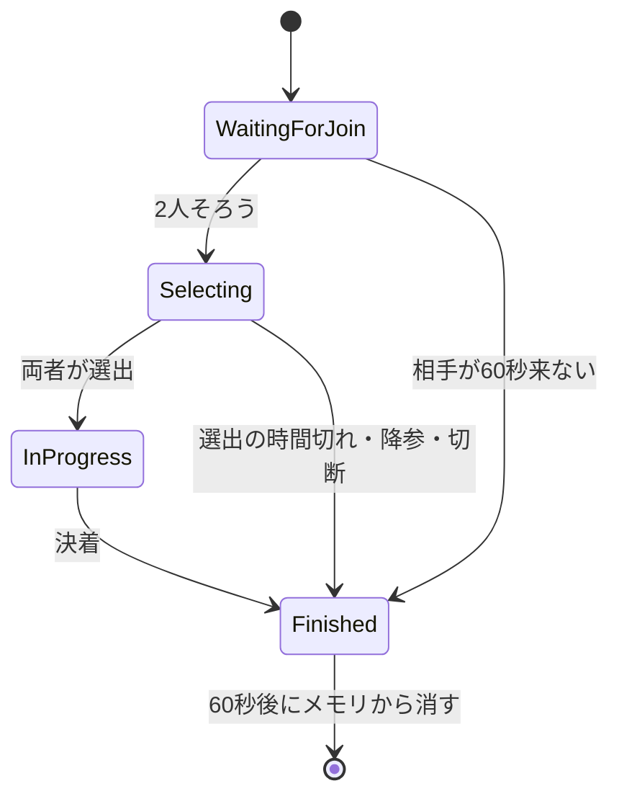

# 対戦の進行

## 制限時間

`BattleTimingOptions` に持つ(既定値は仮の値で、自動テストでは短くする)。

| 項目 | 既定 |
|---|---|
| 選出の制限時間 | 2分 |
| ターンの制限時間 | 30秒 |
| ターンの準備待ちの上限 | 15秒 |
| 放置で負けになる、何もしなかったターンの連続回数 | 3 |
| 切断・未参加の猶予 | 60秒 |
| 決着後にメモリに残す時間(遅れて来た参加に `MatchNotFound` を返すため) | 60秒 |
| 結果報告の再送間隔 | 1秒・5秒・15秒 |

## 参加

- `battle_token` を検証し、`matchId` がトークンと一致するか確かめる。先に参加した側が `player1`
- 新規の参加では、APIサーバーの `GetParty` でその人のパーティを取得して保持する(対戦中に編成を変えても影響させない)。
  取得できなければ `Unavailable` で失敗させ、参加は未確定のまま残す(同じトークンで参加し直せる)
- 相手が来ない場合も、切断と同じ猶予(60秒)で打ち切る
- 2人目がそろったら `Selecting` にし、選出の制限時間を張って、それぞれに `OnSelectionStart` を送る

## 選出

- 検証: 1〜3体、空の ID や重複が無い、すべて参加時のパーティの中の個体(違反は `InvalidArgument`)
- APIサーバーの `GetLoadouts` で選出個体の所持データを取得し、マスタと合わせて BattleCore の型にする。所持していなければ `InvalidArgument`、
  取得できなければ `Unavailable`(選出は未確定のまま残り、送り直せる)
- 所持データの取得を選出時に1回だけにするのは、対戦中に編成・技を変えても影響させないため
- 2回目以降の送信は無視する(再接続後に送り直した場合など)
- 両者がそろったら `InProgress` にし、それぞれに `OnMatchStart` を送る

## ターン

- 行動すべき側の行動がそろったら `BattleEngine.ProcessTurn` で解決し、全員に `OnTurnResult` を送る。制限時間(30秒)が切れたら、送らなかった側は
  何もしない扱いで解決する
- 制限時間は、対戦の開始・ターンの解決の直後からではなく、両者の準備(`ReadyForTurnAsync`)がそろってから数え始め、`OnTurnStart` で両者に知らせる。
  クライアントはターン結果の演出を流し終えてから準備を送る。サーバーには演出の長さ(文の数・早送りしたか)が分からないため、直後から数えると、
  演出の長いターンほどコマンドを選べる時間が減り、相手との間にも差が出る
  - 準備を送らないクライアントや演出の遅い端末で対戦が止まらないよう、そろわなくても上限(15秒)で数え始める
  - 準備が届かないことは切断とはみなさない(生きている接続でも、バックグラウンドに回った等で遅れるため)。切断は接続の切断で検知する
  - 行動は準備待ちの間も受け付け、両者の行動がそろえば数え始める前でも解決する
  - 強制交代ターンも、待っている側を含む両者の準備を待つ
- 技は、選出時に取得した技にあるか(無ければ `InvalidArgument`)と、PP が残っているか(無ければ `FailedPrecondition`)を確かめる。
  交代は、選出の中の生きている控えか(違えば `InvalidArgument`)を確かめる
- 1ターンに1回だけ受け付ける。相手の切断中・相手の強制交代中・送信済みのときは `FailedPrecondition`

## 強制交代

- 前のターンで瀕死になった側の交代だけを受け付け、相手の行動は `FailedPrecondition` で拒否する
- 交代が届いた時点で解決する。相手は `null` の行動として BattleCore に渡すため、結果に相手の `Skip` が入り、ターン番号も進む
- 時間切れは倒れた側の負けで、スキップにはしない(待っている相手の番が来ないため)
- 1ターンで両者が同時に瀕死になることは現在のルールでは無いが、`PlayersRequiringForcedSwitch` の全員の交代がそろった時点で解決する形にしてある
- 以前は強制交代を次のターンの一部として扱い、相手も同じターンに技を送れた。倒れた側だけが不利になるうえ、相手が交代を待たずにコマンドを
  選べてしまうため、本家と同じ方式に変えた

## 決着と時間切れ

| 状況 | 結果 |
|---|---|
| 選出が全員瀕死 | 相手の勝ち(`AllFainted`) |
| 降参 | 相手の勝ち(`Forfeit`)。相手がまだ参加していなければ受け付けない |
| 選出の制限時間(2分)に選ばなかった | 相手の勝ち(`Forfeit`)。両者なら勝者なし |
| 強制交代の時間切れ(30秒) | 相手の勝ち(`Forfeit`) |
| 時間切れで何もしなかったターンが3回続いた(強制交代ターンは数えない) | 相手の勝ち(`Forfeit`)。両者同時なら勝者なし |
| 切断・未参加が60秒続いた | 相手の勝ち(`DisconnectTimeout`)。対戦が始まる前に両者とも不在なら勝者なし |

- 選出の時間切れ・放置に専用の理由は足さず `Forfeit` で表す(`BattleEndReason` は Unity と共有する BattleCore の型のため、値を増やさない)
- 決着したら全員に `OnBattleEnd` を送り、APIサーバーへ結果を報告する([APIサーバーとの連携](api-integration.md))

## 切断と再接続

- 切断は `OnDisconnected` で検知し、相手に `OnOpponentDisconnected` を送って猶予タイマー(60秒)を張る。猶予中は両者とも行動できず、
  ターンのタイマーも止める
- クライアントが黙って消えた(電波が切れた等で切断が届かない)ときにも気付けるよう、MagicOnion のサーバー側のハートビートを使う
  (5秒ごと、10秒応答が無ければ切断扱い。`Program.cs`)。使わないと TCP が切れるまで気付けず、相手は切断中の表示も出ないまま待たされる。
  クライアントは自動で応答する。逆向き(サーバーが消えたことにクライアントが気付く)はクライアント側のハートビートで行う
- 猶予中に同じトークンで `JoinAsync` し直せば再開する。トークンの有効期限(30秒)は猶予より短いため、再接続に限り期限切れ(署名は正当)の
  トークンを受け付ける。新規の参加では期限切れを受け付けない
- 専用の再同期のメソッドは設けず、再接続した人にだけ現在の状態を送り直す(選出中なら `OnSelectionStart`、対戦中なら `OnMatchStart`)。
  Client は受け取った内容で初期化するため、そのまま復元になる。ターンの制限時間は、両者がそろったら戻った側の準備を待って30秒から数え直す
  (待っていた側の準備は切断前のものを残す)
- 盤面だけではターンの途中の状態が戻らないため、`OnMatchStart` には次の3つも入れる(対戦開始時は空・false)
  - 強制交代を求められている側(強制交代ターンなら)。無いと、強制交代ターンの途中で戻った側が交代先の選択や相手の交代待ちを出せない
  - このターンの行動を送信済みか。送信済みの側にもう一度行動を選ばせると、サーバーが「送信済み」で弾くため
  - 相手が切断して猶予中か。両者とも切断し、先に戻った側には `OnOpponentDisconnected` が届かないため
- 猶予中に戻らなければ、切断した側の負け
- Client は接続の切断を検知して、同じトークンで参加し直す([バトル画面](../client/battle-screen.md))
