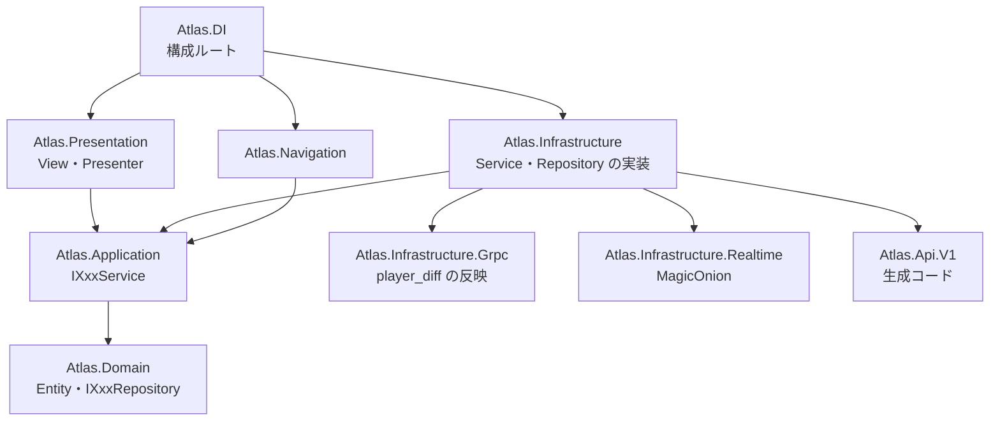

# アセンブリとレイヤー

オニオンアーキテクチャ。Domain を中心に、Application → Presentation・Infrastructure → DI(構成ルート)の順に外側になり、
依存は外側から内側への一方向だけにする(asmdef の参照で強制する)。通信・保存のインターフェースは内側に置き、Infrastructure が実装する。



| asmdef | 置くもの | 主な参照 |
|---|---|---|
| `Atlas.Domain` | Entity、`IXxxRepository`、`IBattleConnection` とその型 | UniTask |
| `Atlas.Application` | `IXxxService`、`IPlayerSession`、`IBattleMatchMaker`/`IBattleConnectionFactory`、戻り値の型、`BattleEntryStore`、`AddressDefinition`(生成物) | Domain, MasterData |
| `Atlas.Infrastructure` | Service の実装(生成したラッパー `XxxApi` を呼ぶ)、Repository の実装、`PlayerSession`、`BattleMatchMaker`、`FileAccountStore`、`MasterDatabaseLoader`、DI 登録の拡張メソッド | Domain, Application, MasterData, Supplement, Atlas.Api.V1, Infrastructure.Grpc, Infrastructure.Realtime, VolTech.Client |
| `Atlas.Infrastructure.Grpc` | `PlayerDiffApplier`/`XxxDiffApplier`/`PlayerSnapshotApplier`(所持データの反映) | Domain, Application, Atlas.Api.V1, VolTech.Client |
| `Atlas.Api.V1` | `.proto`・`errors.toml` から生成した C#(`Infrastructure/Grpc/Generated/`。手で編集しない) | VolTech.Client, VolTech.V1 |
| `Atlas.Infrastructure.Mock` | 偽のサーバー `FakeServer`、`MockBattleConnection`/`MockBattleMatchMaker`、`TestPartyFactory` | Domain, Application, MasterData, BattleCore, Atlas.Api.V1 |
| `Atlas.Infrastructure.Realtime` | `RealtimeBattleConnection`(MagicOnion のクライアント) | Domain, Application, BattleContracts, BattleCore |
| `Atlas.Navigation` | `TransitionAwareSceneNavigator`、`ErrorNavigator`(通信エラーの後の画面遷移) | USN, Application, VolTech.Client |
| `Atlas.Presentation` | View・Presenter・ViewDto(画面単位の型だけ)、`ErrorDialog` | Domain, Application, MasterData, USN, VContainer, R3, LitMotion |
| `Atlas.DI` | `RootLifetimeScope`/`HomeLifetimeScope`/`BattleLifetimeScope`(構成ルート) | すべて |
| `Atlas.MasterData` | マスターデータの生成物とローダー、能力の計算(`PachimonStatCalculator`)、技グループから技を引くクエリ(`PachimonMoveLookup`) | (なし) |
| `Atlas.BattleCore` / `Atlas.BattleContracts` | リポジトリの `Shared/` をローカルパッケージとして参照する | |

- `Atlas.DI` だけが全レイヤーに依存してよい最上位のアセンブリ。シーン単位の `LifetimeScope` はすべてここに置く。
  `Atlas.Presentation` は `Atlas.Infrastructure` も `Atlas.DI` も参照しない
- Presenter は `IXxxService`(Application)越しにしか通信しないため、実装が何かを知らない

## `Atlas.Presentation` のフォルダ

```
Presentation/
├── Common/        機能に属さない共通の型(PaletteColor、PachimonTypeNames、PachimonTypeBadgeView、ErrorDialog 等)
├── GlobalHeader/  アウトゲームに共通のヘッダー(GlobalHeaderView・GlobalHeaderPresenter)
├── Title/
├── Home/          HomePage・HomePresenter・HomeViewDto
│   └── Matchmaking/       Modal(1 Modal = 1フォルダ)
├── Party/         パーティ編成。ほかの機能でも使う部品(PachimonInfoView・PachimonListView 等)もここ
├── Training/      育成。TrainingPage・TrainingPresenter・TrainingStatAllocation(割り振りの調整)
│   ├── Views/     TrainingPage の部品(技・ステータスのタブ)
│   └── MoveReplace/ DiscardAdjustment/ TicketShortage/
├── Shop/
│   └── Confirm/
├── Scout/
│   └── Confirm/
└── Battle/        BattlePage・BattlePresenter
    ├── Views/     BattlePage の部品(CommandView・SelfInfoView・HpGaugeView 等)
    └── Selection/ Switch/ Forfeit/ OpponentSwitching/ Result/
```

- Page は機能名の直下、Modal は機能名の下に Modal ごとのフォルダを切る(namespace は機能名のまま)。Page の部品が多ければ `Views/` にまとめる
- 他の機能と共用する部品は、最初に作った機能のフォルダに置いたまま参照する
- prefab は Modal も含めて `Assets/Addressables/Views/{機能名}/` の直下に置く(prefab は1画面1ファイル、C# は1画面4〜5ファイルになるため、C# だけフォルダを切る)。
  機能をまたぐ部品(`GlobalHeader` 等)の prefab は `Views/Parts/` に置く

## 採用しなかった案

- 1画面ごとにフォルダを切る(`Party/PartyEdit/PartyEditPage.cs`): 1機能1 Page のため、機能名のフォルダの直下が空になるだけだった
