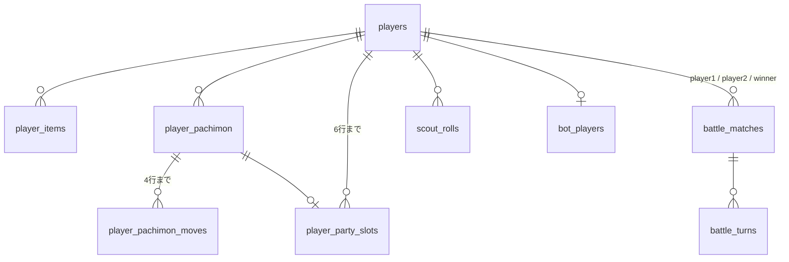

# DB

MySQL。唯一のデータストアで、書き込むのは APIサーバーだけ。

## 方針

- スキーマは `Server/migrations/` のマイグレーション(`sqlx migrate`)で管理する。gRPC 基盤のテーブルと合わせて、APIサーバーの起動時に流す
- プレイヤーの操作で生成する行の主キーは ULID(`CHAR(26)`)。日時は `DATETIME(3)`
- `NULL` を許す列はなるべく作らない。「無い」ことは行が無いことで表す([値なしの表し方](../conventions/nullable.md))
- 所持データの「割当」(パーティの枠・覚えている技)は、元のテーブルの列ではなく専用のテーブルにする。未設定を行が無いことで
  表せ、nullable を使わずに済むため
- マスタのテーブル(`pachimon` 等)も DB に置く。列は [マスターデータのテーブル](../master-data/tables.md) に書く
- マッチングの待機列と対戦の進行中の状態は DB に置かない(サーバーのメモリ)

## テーブルのつながり

基盤のテーブルとマスタは省いている。



## players

プレイヤー。サインアップ(`SignUp`)と、ボットを作るとき(マッチング)に作る。

| 列 | 型 | 制約 | 説明 |
|---|---|---|---|
| `player_id` | CHAR(26) | PK | デバイス登録で基盤が発行した ULID |
| `nickname` | VARCHAR(50) | NOT NULL | |
| `created_at` | DATETIME(3) | NOT NULL | |

ジェム等の数は持たない(`player_items` で持つ)。デバイスとの対応は基盤の `devices` だけが持つので、`device_id` は持たない。

## player_items

所持アイテム(ジェム・育成チケット)の数。サインアップ・スカウト・ショップ・育成・対戦の結果・開発用の API が書き込む。

| 列 | 型 | 制約 | 説明 |
|---|---|---|---|
| `player_id` | CHAR(26) | PK(複合), FK → `players` | |
| `item_id` | INT | PK(複合), FK → `items` | `1` がジェム、`2` が育成チケット |
| `quantity` | INT | NOT NULL | 所持数(絶対値) |
| `updated_at` | DATETIME(3) | NOT NULL | |

- 個々の行を独立したエンティティとして指す必要が無いため、ULID ではなく `(player_id, item_id)` の複合主キーにしている
- 一度も手に入れていないアイテムは行が無い。使って0になった行は消さずに残す
- 増減の仕方は [所持リソース](../conventions/items.md)

## player_pachimon

所持しているパチモンの個体(1行が1体)。サインアップ(スターター)・スカウト・ボットの作成・開発用の API で作り、
ステータスポイントの割り振り(`SetPachimonStatPoints`)で書き換える。

| 列 | 型 | 制約 | 説明 |
|---|---|---|---|
| `player_pachimon_id` | CHAR(26) | PK | |
| `player_id` | CHAR(26) | NOT NULL, FK → `players` | |
| `pachimon_id` | INT | NOT NULL, FK → `pachimon` | 種族 |
| `effort_values` | JSON | NOT NULL | 能力に割り振ったステータスポイント。`{"hp","atk","def","spatk","spdef","speed"}`、入手時はすべて0 |
| `obtained_at` | DATETIME(3) | NOT NULL | |

- レベルは列を持たない(全員50の固定値)。個体値も持たない
- `effort_values` のポイントは、どれも0以上、合計64以下。能力の値にそのまま足す([パーティ編成・育成](../server/party.md))。
  列名は努力値のころのまま(名前を変えるだけのマイグレーションをしていない)

## player_pachimon_moves

個体が覚えている技(1個体4行まで)。個体を作るときに、技グループの初期技(`move_group_moves.is_initial`)を複製する。
技の付け替え(`SetPachimonMove`)で書き換える。

| 列 | 型 | 制約 | 説明 |
|---|---|---|---|
| `player_pachimon_move_id` | CHAR(26) | PK | 割当の ID。付け替えでは変わらない |
| `player_pachimon_id` | CHAR(26) | NOT NULL, FK → `player_pachimon` | |
| `slot` | INT | NOT NULL | 1〜4。`UNIQUE(player_pachimon_id, slot)` |
| `move_id` | INT | NOT NULL, FK → `moves` | |

## player_party_slots

パーティの編成(1プレイヤー6行まで)。サインアップ・パーティ編成・ボットの作成・開発用の API が書き込む。

| 列 | 型 | 制約 | 説明 |
|---|---|---|---|
| `party_slot_id` | CHAR(26) | PK | 割当の ID。編成し直すたびに作り直す |
| `player_id` | CHAR(26) | NOT NULL, FK → `players` | |
| `slot` | INT | NOT NULL | 1〜6。`UNIQUE(player_id, slot)` |
| `player_pachimon_id` | CHAR(26) | NOT NULL, FK → `player_pachimon` | `UNIQUE(player_id, player_pachimon_id)`(同じ個体を2つの枠に入れない) |
| `created_at` | DATETIME(3) | NOT NULL | |

## scout_rolls

スカウトの紹介と選択の記録。紹介(`Roll`)で作り、選択(`Select`)で選んだ候補を書き込む。

| 列 | 型 | 制約 | 説明 |
|---|---|---|---|
| `roll_id` | CHAR(26) | PK | |
| `player_id` | CHAR(26) | NOT NULL, FK → `players` | |
| `banner_id` | CHAR(26) | NOT NULL, FK → `scout_banners` | |
| `candidates` | JSON | NOT NULL | 候補10体。各要素は `{"pachimon_id","rarity","moves"}`(`rarity` は `"S"`〜`"C"` の文字列) |
| `selected_index` | INT | NULL 可 | 選んだ候補(0〜9)。未選択は `NULL` |
| `created_at` | DATETIME(3) | NOT NULL | 紹介を受けた日時(ジェムを消費した日時) |
| `selected_at` | DATETIME(3) | NULL 可 | 選んだ日時 |

候補と選択結果をまとめて記録し、紹介と入手の履歴を兼ねる。

## bot_players

対戦相手のボットとして使うプレイヤー。ボットとのマッチが成立するとき、10人に届くまでは新しく作る([マッチング](../server/matchmaking.md))。

| 列 | 型 | 制約 | 説明 |
|---|---|---|---|
| `player_id` | CHAR(26) | PK, FK → `players` | |

- ボットも `players` に行を持つ普通のプレイヤーで、このテーブルに載っているかで区別する。パーティ・所持データは人と同じテーブルに持つ
- 行が無いのは「ボットではない」。`players` に `is_bot` の列を足さなかったのは、プレイヤーの行を読む処理に影響させないため

## battle_matches

対戦(1対戦1行)。マッチ成立で作り、結果報告(内部 API の `ReportResult`)と後始末で書き換える。

| 列 | 型 | 制約 | 説明 |
|---|---|---|---|
| `match_id` | CHAR(26) | PK | |
| `player1_id` / `player2_id` | CHAR(26) | NOT NULL, FK → `players` | `player1` は先に待機列にいた側。ボットとの対戦ではボットが `player2` |
| `status` | ENUM('matching','in_progress','finished','aborted') | NOT NULL | マッチ成立時に `in_progress` で作る(`matching` は使わない)。`aborted` は勝者なしの終了 |
| `winner_id` | CHAR(26) | NULL 可, FK → `players` | `finished` のときだけ |
| `player1_selected_pachimon` / `player2_selected_pachimon` | JSON | NULL 可 | 選出した `player_pachimon_id`(選んだ順)。結果報告で必ず設定するため、`NULL` なら未報告 |
| `started_at` / `ended_at` | DATETIME(3) | NULL 可 | |

状態の移り変わり:

```
(マッチ成立) → in_progress ─┬─ 結果報告(勝者あり)          → finished
                            ├─ 結果報告(勝者なし)          → aborted
                            └─ 1時間報告が無い(後始末)    → aborted ──(後から報告)→ finished / aborted
```

報酬の付与履歴のテーブルは持たない(`winner_id` と固定額から計算し直せるため)。バトルサーバーの ID も持たない(1台構成のため)。

## battle_turns

対戦の行動ログ。結果報告で書き込む。

| 列 | 型 | 制約 | 説明 |
|---|---|---|---|
| `turn_id` | CHAR(26) | PK | |
| `match_id` | CHAR(26) | NOT NULL, FK → `battle_matches` | |
| `turn_number` | INT | NOT NULL | |
| `player_id` | CHAR(26) | NOT NULL, FK → `players` | 行動した側 |
| `action_data` | JSON | NOT NULL | `{"type": "Move"/"Switch"/"Skip", "moveId", "partySlot"}` |
| `result_data` | JSON | NOT NULL | `{"hit","critical","effectiveness","damageDealt","targetRemainingHp","targetFainted","newActiveIndex"}` |
| `created_at` | DATETIME(3) | NOT NULL | |

- 1ターン内の行動ごとに1行
- `action_data`・`result_data` はバトルサーバーが作り、APIサーバーは解釈せずに保存する。HP の実数やダメージ量など、
  クライアントには送らない値も含む

## マスタのテーブル

`pachimon`・`moves`・`move_groups`・`move_group_moves`・`starter_party_slots`・`items`・`shop_products`・`scout_banners`・
`scout_banner_rates`。`seed_master_data` だけが書き込む。列は [マスターデータのテーブル](../master-data/tables.md) に書く
(`type_chart` は DB に置かない)。

## 基盤のテーブル

gRPC 基盤のクレートのマイグレーションが作る(履歴は `_auth_migrations`・`_transaction_migrations`。Atlas の `_sqlx_migrations`
とは別)。列は基盤が決めるので、ここには書かない。

| テーブル | 説明 | 書き込み元 |
|---|---|---|
| `devices` | 登録されたデバイスと、その `player_id` | `DeviceService/Register` |
| `access_tokens` | デバイスごとのアクセストークン(1デバイス1行) | `DeviceService/IssueToken` |
| `last_responses` | 冪等性の対象の RPC の直前のレスポンス(1プレイヤー1行) | 冪等性の対象の RPC・サインアップ |
| `game_logs` | 所持データの変化の履歴([ゲームログ](../server/game-log.md)) | 所持データを変える RPC・内部 API の `ReportResult` |

基盤のテーブルの `player_id` は `BINARY(16)` で、Atlas のテーブルの `CHAR(26)` とはつなぎ目で変換する。基盤は Atlas の `players` を
知らないので、外部キーは張らない。

## マイグレーションの注意

適用済みのマイグレーションの SQL を書き換えると、ローカル DB の `_sqlx_migrations` のチェックサムと合わなくなる。書き換えた場合は、
ファイルの SHA-384 でチェックサムを更新するか、DB を作り直す(`server-dev-env` スキル)。

## 採用しなかった案

- `player_pachimon` に `party_slot`(NULL 可)の列を持たせる: 未編成を `NULL` で表すことになり、API に nullable が出てくるため
