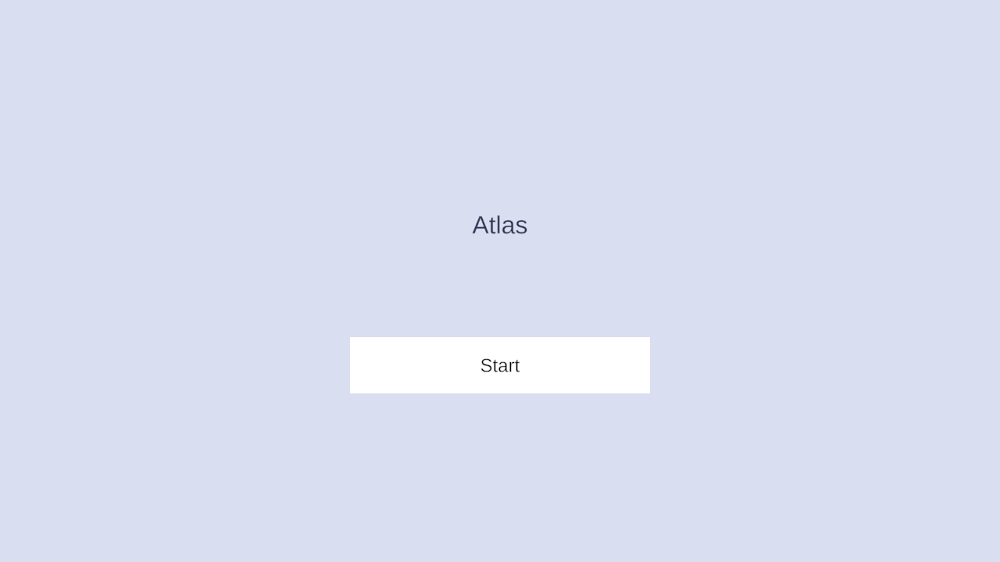

# タイトルとアカウント

会員登録は無く、タイトルで「スタート」を押すだけで遊び始められる。初回は端末ごとのゲストアカウントを作り、
スターターパーティとジェムを受け取って、すぐに対戦できる状態から始まる。

## できること

- 「スタート」でサインインする。初回は端末ごとのゲストアカウントを自動で作る(メールアドレス・パスワード等の入力は無い)
- 初回はプレイヤーを作成し、次のものを受け取る
  - スターターパーティ: 全プレイヤー共通の固定6体(レア度 C の6体)。受け取った時点でパーティに編成済みで、すぐに対戦できる
  - ジェム 300(スカウト2回分)。初回起動の時点でスカウトを試せるようにするため
- ニックネームの入力画面は無く、作成時は固定の「プレイヤー」になる([#38](https://github.com/chinpanGX/Atlas/issues/38))
- 別の端末への引き継ぎは無い

## 作りの要点

| 層 | していること | 詳しく |
|---|---|---|
| gRPC 基盤 | 端末の登録・トークンの発行と更新・再送しても一度だけ処理する仕組みを、自作の基盤([VolTech gRPC](https://github.com/chinpanGX/VolTech-gRPC))が受け持つ。Atlas は業務処理だけを書く | [認証](../server/auth.md) |
| APIサーバー | プレイヤーの作成と、スターターパーティ・ジェムの付与を1つのトランザクションで行う。途中で失敗しても「プレイヤーはいるがパーティが空」にならない | [プレイヤー](../server/player.md) |
| APIサーバー | 同時のサインアップでデッドロックしないよう、「無いことを確かめてから作る」ではなく「作ってみて重複なら作成済み」として扱う | [プレイヤー](../server/player.md) |
| クライアント | サインインで所持データの全件(`snapshot`)を受け取って手元を置き換え、その後は各 API の差分(`player_diff`)で追従する | [サインイン](../client/sign-in.md)・[所持データの差分](../conventions/player-diff.md) |
| クライアント | 端末のアカウント情報は、Supplement の暗号化・改ざん検知付きのセーブでファイルに保存する。読めないファイルは保存が無いものとして登録し直し、起動できなくなるのを避ける | [サインイン](../client/sign-in.md) |
