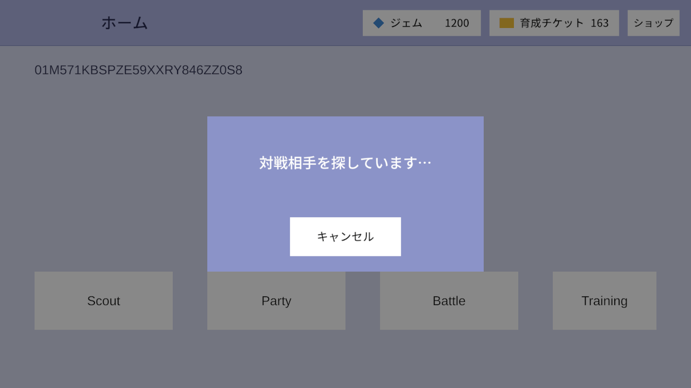
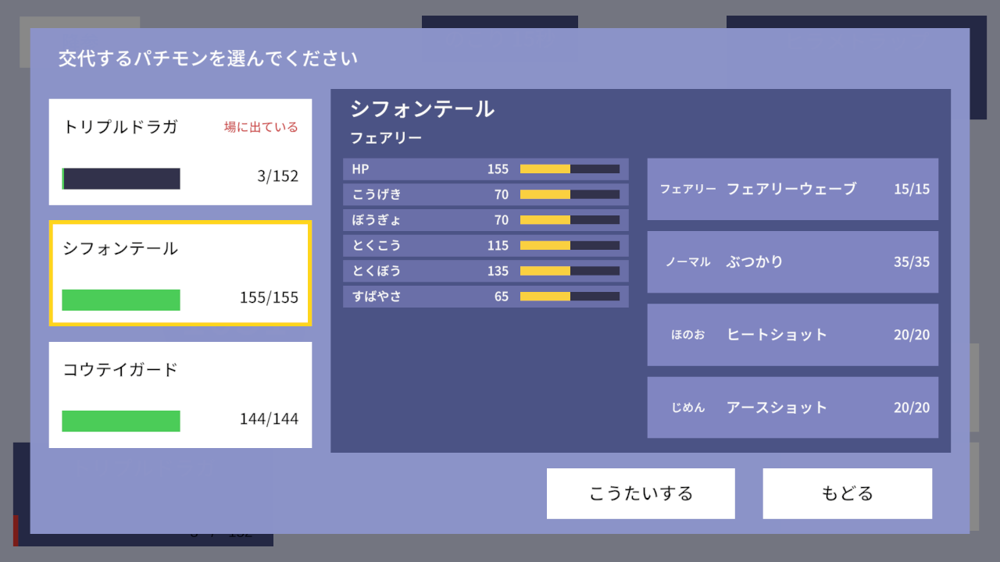
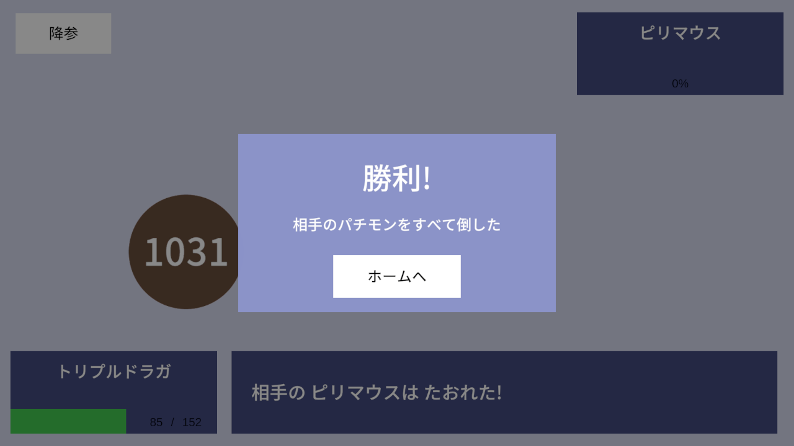
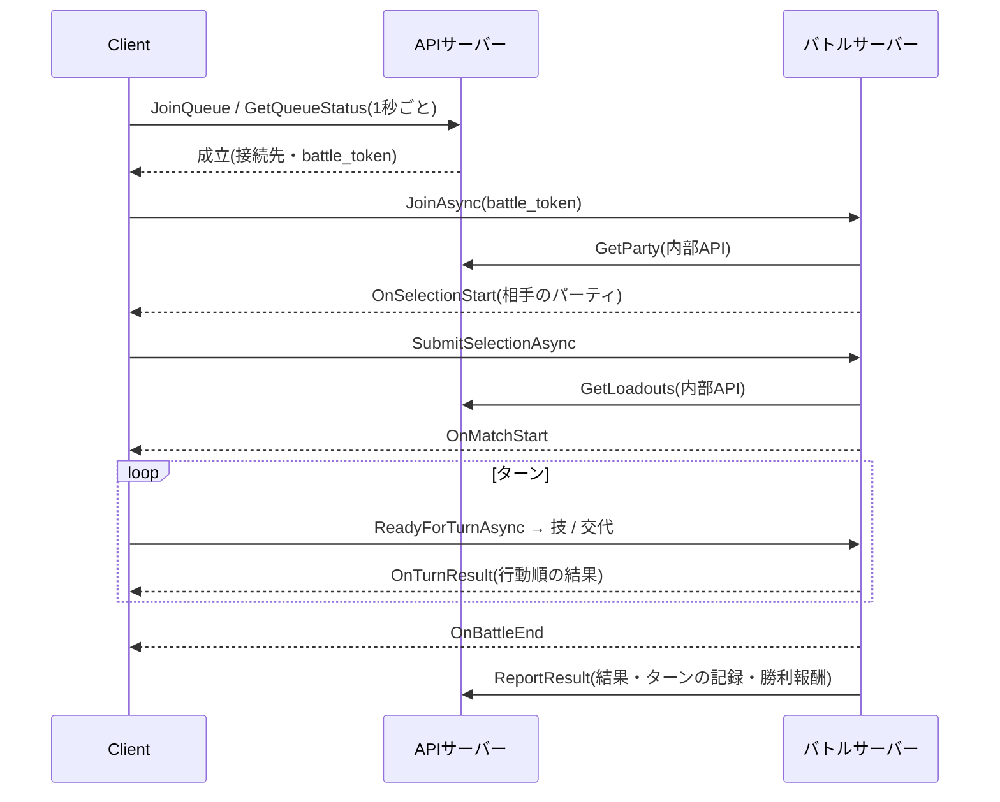

# 対戦

ほかのプレイヤーとリアルタイムで1対1の対戦をする。お互いのパーティを見せ合って3体を選び、毎ターン技か交代を選んで戦う。
判定はすべてバトルサーバーが行い、通信が切れても60秒以内なら続きから再開できる。

## マッチング

- 対戦ボタンでマッチングの待機列に入り、もう1人が来たら対戦相手が決まる(先着順。強さによる組み分けは無い)
- 10秒待っても相手が来なければ、ボットが対戦相手になる。遊ぶ人が少ない時間でも対戦を始められるようにするため。
  ボットであることは画面に出さず、ルール・制限時間・勝利の報酬は人との対戦と同じ
- ボットは選出も技もランダムに選ぶ(強さの調整はまだしていない)
- 待っている間はキャンセルできる

## 選出

- 対戦相手が決まると選出画面になり、お互いのパーティ(どのパチモンか)を見せ合う。相手の技や能力の振り方は見えない
- 自分のパーティから3体を選ぶ(パーティが3体未満ならその体数)。選んだ順番がそのまま並びになり、1番目が最初に場に出る
- 選んだパチモンをタップすると、画面中央にその能力と技を表示する
- 「けってい」を押すと、相手が選び終わるまで選出画面のまま待つ。両者がそろったら対戦が始まる
- 制限時間は2分。時間内に選ばなかった側の負け(両者とも選ばなかった場合は勝者なし)

## ターンの進み方

- 毎ターン、お互いに「技を使う」か「控えと交代する」を1つ選ぶ。制限時間は30秒
- 時間内に選ばなかった場合、そのターンは何もしない(相手の行動だけが行われる)
- 両者の行動がそろったら、次の順番で行動する
  1. 交代は技より先
  2. 技どうしは、すばやさが高い方が先。同じならランダム(先制技は無い)
- 行動の結果は、行動した順に1文ずつメッセージで流れ、HP ゲージもそれに合わせて減る
- 物理技は体当たり、特殊技は技のタイプの色のビームで演出し、攻撃を受けた側は相性(ばつぐん・いまひとつ等)に応じた大きさで揺れる

## 技とダメージ

- 技を選んだ時点で PP を1使う(外れても使う)。PP が0の技は選べない
- 命中率に従って当たり外れが決まる
- ダメージは本家の基本式を使う。攻撃側のこうげき(物理)/とくこう(特殊)と、防御側のぼうぎょ/とくぼうで決まり、
  さらに次の倍率がかかる

| 倍率 | 内容 |
|---|---|
| タイプ一致 | 技のタイプが使うパチモンのタイプと同じなら1.5倍 |
| タイプ相性 | 0倍(効果なし)・0.5倍(いまひとつ)・1倍・2倍(ばつぐん)。相手が2タイプなら2回かけ合わせ、4倍は「超ばつぐん」・0.25倍は「超いまひとつ」と表示する |
| 急所 | 1/16の確率で1.5倍 |
| 乱数 | 0.85〜1.00倍 |

式は [バトルの計算(Atlas.BattleCore)](../battle-server/battle-core.md)。

## 瀕死と交代

- HP が0になると瀕死になり、そのパチモンは行動できない
- 自分のパチモンが瀕死になったら、次のターンは「強制交代ターン」になり、控えから次に出すパチモンを選ぶ。
  この間、相手は待つ(何も選べない)。生き残りが1体でも自動では選ばれない
- 強制交代の制限時間は30秒。時間内に選ばなかった場合は負け

## 相手の情報の見え方

- 相手のパチモンは、場に出るまでどの3体を選んだか分からない(枠の数と、何体倒れたかは分かる)
- 相手の HP は%で表示する(実数は分からない)。自分の HP も%で表示する

## 勝敗

| 決着の仕方 | 勝者 |
|---|---|
| 相手の選出3体をすべて倒した | 倒した側 |
| 降参した | 相手 |
| 選出の制限時間内に選ばなかった | 相手(両者なら勝者なし) |
| 強制交代の制限時間内に交代しなかった | 相手 |
| 3ターン続けて何もしなかった(放置。強制交代ターンは数えない) | 相手(両者同時なら勝者なし) |
| 接続が切れて60秒以内に戻らなかった(対戦相手が一度も来なかった場合を含む) | 相手(対戦が始まる前に両者とも不在なら勝者なし) |

- 接続が切れている間(最大60秒)は、お互いに行動できない。60秒以内に戻れば続きから再開する(クライアントが自動でつなぎ直す)
- 勝つとジェム50をもらえる。負けたとき・勝者なしのときはもらえない
- 対戦の結果と各ターンの行動は記録される

対戦中の送った行動の取り消し、チャット・リアクション、観戦は無い。

## 作りの要点

Atlas でいちばん手をかけたところ。対戦の判定はバトルサーバーだけが持ち、クライアントは結果を受け取って演出する。

| テーマ | していること | 詳しく |
|---|---|---|
| サーバー権威 | 判定はバトルサーバーだけが行う。HP は%でしか送らず、相手の選出は場に出るまで送らない。ボットも人のクライアントと同じ通知だけで判断し、盤面を覗かない | [通信契約](../battle-server/contracts.md)・[対戦の進行](../battle-server/battle-flow.md) |
| 計算の共有 | ダメージ計算・ターン処理(`Atlas.BattleCore`)は Unity とバトルサーバーが同じソースをコンパイルする。技の効果はイベントのハンドラで足せる構造 | [バトルの計算](../battle-server/battle-core.md) |
| 公平な制限時間 | ターンの制限時間は、両者がターン結果の演出を見終えて準備を送ってから数え始める。演出の長さで選べる時間が減らない | [対戦の進行](../battle-server/battle-flow.md)・[バトル画面](../client/battle-screen.md) |
| 切断と再接続 | サーバーは60秒の猶予を持ち、戻った人に今の状態とターンの途中の状態(強制交代・送信済み・相手の切断)を送り直す。クライアントは同じトークンで自動でつなぎ直す | [対戦の進行](../battle-server/battle-flow.md)・[バトル画面](../client/battle-screen.md) |
| ボット | 10秒で相手が来なければ、APIサーバーがボットと組ませ、バトルサーバーの中でボットを動かす。進行のロジックは相手が人かボットかを区別しない | [マッチング](../server/matchmaking.md)・[対戦の進行](../battle-server/battle-flow.md) |
| DB の書き込みを1か所に | バトルサーバーは DB を持たず、パーティの取得と結果の報告を内部 API で行う。報告は再送しても二重に記録せず、届かない対戦は定期的に打ち切る | [APIサーバーとの連携](../battle-server/api-integration.md)・[内部API](../server/internal-api.md)・[後始末](../server/stale-match-cleanup.md) |
| 演出 | 結果は行動順に1文ずつ流し、HP ゲージ・技の演出(LitMotion)を合わせる。演出中に届いた結果は割り込ませず後ろに並べる | [バトル画面](../client/battle-screen.md) |
| テスト | インプロセスで起動したサーバーに MagicOnion のクライアント2つで接続する結合テストと、本物のクライアントと同じ経路で自動対戦する `BattleBot`(`--count 2` でボット同士)で確かめる | [テストとボット](../battle-server/testing-and-bot.md) |
