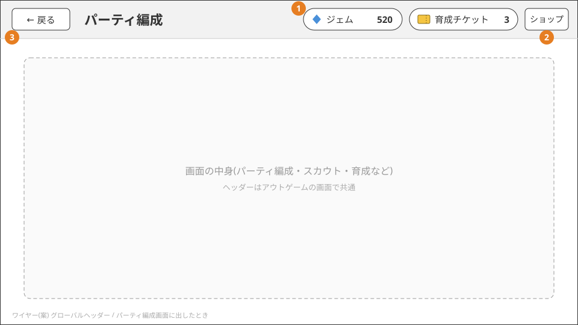

# ホームと画面の流れ

ホームは、スカウト・パーティ編成・育成・対戦の4つの入口になる画面。どの画面にも共通のヘッダーを出し、所持しているジェムと
育成チケットの数をいつでも確かめられるようにしている。


## 画面の流れ

```
起動 ─→ タイトル(「スタート」でゲスト認証。初回はプレイヤーを作成)
          ↓
        ホーム ─┬─ パーティ編成
                ├─ スカウト
                ├─ 対戦 ─→ マッチング待ち ─→ 選出 ─→ 対戦 ─→ 結果 ─→ ホーム
                └─ 育成(パーティ編成の「育成する」からも開く)

アウトゲームの各画面 ─(グローバルヘッダーの「ショップ」)─→ ショップ ─(戻る)─→ 元の画面
```

- 開発用に、ホームにジェムを付与するボタンがある(正式な機能ではない。[ゲーム紹介](index.md)の「ジェム」)
- 通信エラーで「タイトルへ」を選ぶと、手元の所持データを捨ててタイトルからやり直す

## グローバルヘッダー

アウトゲームの画面に共通で出すヘッダー。



1. 所持しているジェムと育成チケットの数を出す。スカウト・育成・ショップのどこでも「あといくらあるか」を確かめられるようにするため
2. 「ショップ」でショップを開く。ホームを含むどの画面でも押せる。ショップは今の画面の上に開き、戻ると元の画面に戻る。
   画面を切り替える(タブのように入れ替える)と、育成の途中で選んでいた個体や編集中の内容が消えるため。ショップの中では出さない
   (ショップの上にショップを重ねないため)
3. 戻るは1つ前の画面に戻る(今までどおり)。ホームでは出さない

- パーティ編成は、ヘッダーの戻るで離れるときに変更を保存する。保存に失敗したら画面に留まる
- ヘッダーに置くのは、所持数とショップだけにする。機能(パーティ編成・スカウト・対戦・育成)は5つと少なく、ホームから入れば足りるため
- 途中で抜けると進行が壊れる画面では、ヘッダーを出さないか押せなくする: マッチング待ち、選出、対戦、スカウトで候補を選んでいる間(選ぶまで戻れない)

## 作りの要点

| 層 | していること | 詳しく |
|---|---|---|
| クライアント | 画面は View と Presenter に分け、UnityScreenNavigator(フォーク)で Push/Pop する。別々の場所から来た遷移が重なっても、フォークで順番待ちにして失敗させない | [画面の構成](../client/screens.md)・[画面遷移](../client/navigation.md) |
| クライアント | Bootstrap・Home・Battle の3シーンに VContainer のスコープを対応させる。Bootstrap は一度もアンロードせず、通信・所持データ・エラーダイアログを常駐させる | [シーンとスコープ](../client/scenes-and-scopes.md) |
| クライアント | 通信エラーのダイアログのボタン(OK・再試行・タイトルへ など)は、エラーごとの既定の action で gRPC 基盤が決める。画面ごとにエラー処理を書かない | [通信エラーのダイアログ](../client/error-dialog.md) |

## 採用しなかった案

- 所持数の横に「＋」を置いてショップを開く: ショップの商品は育成チケットだけで、ジェムは買えない(対戦の勝利で増える)。ジェムの横の
  「＋」を押した人はジェムを買えると期待するので、何が開くかを「ショップ」と書いたボタン1つにした
- ヘッダーにホームへ戻るボタンを置く: 画面の深さは最大でも「ホーム → 育成 → ショップ」の3段で、戻るを2回押せば足りる。空いた場所に
  ショップを置いた
