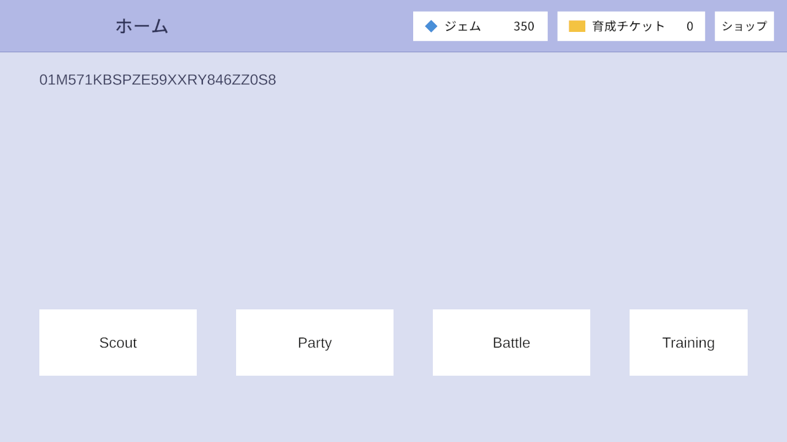

# ゲーム紹介

「パチモン」と呼ぶモンスターをスカウトで集めて育成し、パーティを組んで、ほかのプレイヤーとリアルタイムで1対1の対戦をする。
会員登録は無く、「スタート」を押すだけで始められる。本家ポケモンの対戦ルールから、天候・フィールド・持ち物・特性・技の追加効果などを
外した、小さなルールで遊ぶ。

## 機能

| | |
|---|---|
| [](account.md)<br>**[タイトルとアカウント](account.md)**<br>「スタート」だけで始められるゲストアカウント | [](home.md)<br>**[ホームと画面の流れ](home.md)**<br>各機能への入口と、所持数を出す共通のヘッダー |
| [](scout.md)<br>**[スカウト](scout.md)**<br>候補10体から1体を選んで仲間にする | [](party-training.md)<br>**[パーティ編成・育成](party-training.md)**<br>6体を編成し、技とステータスを調整する |
| [](shop.md)<br>**[ショップ](shop.md)**<br>ジェムで育成チケットを買う | [](battle.md)<br>**[対戦](battle.md)**<br>選出から決着まで、リアルタイムの1対1 |

パチモンの種族・タイプ・技は [パチモン](pachimon.md)。

## コアループ

```
① スカウトでパチモンを集める(ジェムを使う)
      ↓
② 育成する(技の付け替え、ステータスポイントの割り振り。どちらもジェムで交換したチケットを使う)
      ↓
③ パーティを編成する(最大6体)
      ↓
④ マッチングに参加し、対戦相手と組む(10秒待っても相手が来なければ、ボットが相手になる)
      ↓
⑤ パーティを見せ合って3体を選び、リアルタイムで対戦する
      ↓
① へ戻る(勝つとジェムがもらえる。ジェムはスカウトと、ショップでの育成チケットの購入に使う)
```

## 用語

| 用語 | 意味 |
|---|---|
| パチモン | 集めて戦わせるモンスター。種族ごとにタイプ・能力・覚えられる技が決まっている |
| 個体 | プレイヤーが所持している1体1体のパチモン。同じ種族を複数持てる |
| ジェム | スカウトとショップで使う通貨。対戦に勝つと増える |
| スカウト | ジェムを使ってパチモンを入手する抽選(ガチャ) |
| パーティ | 対戦に連れていく最大6体 |
| 育成 | 個体の技を付け替えたり、ステータスポイントを割り振ったりして、対戦向けに調整すること |
| ステータスポイント | 個体ごとに持つ64ポイント。6つの能力に自由に割り振って能力を上げる |
| 育成チケット | ショップでジェムと交換するアイテム。技の付け替え1回で5枚、ステータスポイントは増やした1ポイントにつき1枚使う |
| ショップ | ジェムでアイテムを購入する場所 |
| 選出 | 対戦の直前に、パーティから実際に戦わせる3体を選ぶこと |

## ジェム

| 増減 | きっかけ | 量 |
|---|---|---|
| 増える | プレイヤー作成時 | 300 |
| 増える | 対戦の勝利 | 50 |
| 増える | 開発用の付与ボタン(正式な機能ではない) | 450 |
| 減る | スカウトの紹介1回 | 150 |
| 減る | ショップでの購入(育成チケット10枚・100枚・200枚) | 50・450・800 |

- 所持数の増減はすべてサーバーが決める
- 報酬額とスカウト・育成チケットの値段のバランスは仮の値([#37](https://github.com/chinpanGX/Atlas/issues/37))
- 作りは [所持リソース(アイテム)](../conventions/items.md)

## 対象外にしたもの

小さなルールで遊べるようにするため、次のものは入れていない。

| 分類 | 入れていないもの |
|---|---|
| 対戦 | 天候・フィールド・持ち物・特性・性格・技の追加効果(状態異常・能力変化)・先制技・急所率の変化・命中/回避の変化 |
| 育成 | レベルアップ、個体値 |
| スカウト | 期間限定スカウトの運用(運用ツール)、色違い、紹介の取り直し |
| 報酬 | デイリーミッション・ログインボーナス、負けたときの参加賞 |
| 交流 | チャット(プレイヤー同士のメッセージ)。使う画面が無く、遊びの流れにも関わらないため入れない |
| その他 | 不正対策(複数アカウントでわざと負ける対戦など)、アカウントの引き継ぎ |

天候・特性・持ち物は恒久的に対象外として、バトルの計算にもそれらの拡張点を作っていない([バトルの計算](../battle-server/battle-core.md))。
今後の検討は [GitHub Issues](https://github.com/chinpanGX/Atlas/issues)。
