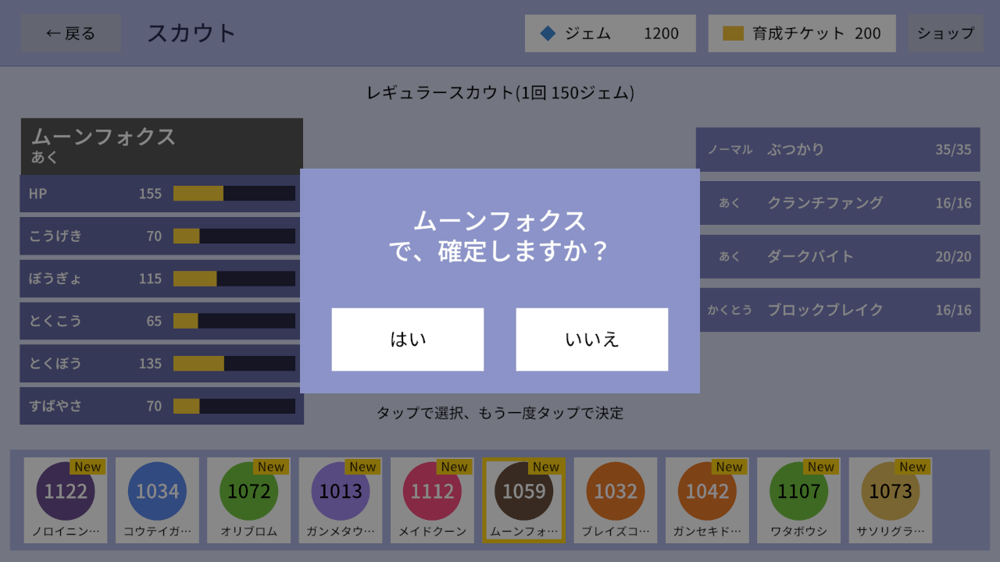

# スカウト

ジェムを払って新しいパチモンを手に入れる抽選(ガチャ)。本家ポケモンの「紹介(候補10体から1体を選ぶ)」をもとにしていて、
提示された10体の中から、どれを仲間にするかを自分で選べる。

## ルール

- 開催中のスカウトから1つ選び、ジェムを払って「紹介」を受ける(現状は常設の「レギュラースカウト」のみ、1回150ジェム)
- 紹介ごとに候補10体が提示され、その中から1体を選んで入手する
  - 選ばなかった9体は消える
  - 候補を選ぶまでスカウト画面から戻れない(選ばずにアプリを終了すると、その紹介は選べなくなり、ジェムも戻らない)
- 候補10体は1体ずつ次の確率でレア度を決め、そのレア度の種族から等確率で選ぶ(同じ種族が複数出ることもある)

| レア度 | 確率 |
|---|---|
| S | 3% |
| A | 12% |
| B | 35% |
| C | 50% |

- 入手した個体は初期技4つを覚えている
- 排出率はクライアントに渡さない(表示もしない)

## 画面

候補をタップすると詳細を出し、同じ候補をもう一度タップすると確認へ進む。

- 入手の通信に失敗したら候補を残し、もう一度タップすれば送り直せる
- 選ぶまでヘッダーを押せない(ジェムを払った紹介を、選ばずに離れて失わないようにするため)

## 作りの要点

| 層 | していること | 詳しく |
|---|---|---|
| APIサーバー | 「紹介(`Roll`)」と「選択(`Select`)」の2段階。紹介でジェムの消費と候補10体の抽選・保存を1つのトランザクションで行い、選択では保存した候補をそのままコピーする(再抽選しない) | [スカウト(API)](../server/scout.md) |
| APIサーバー | 同時に選んでも二重に入手しないよう、紹介の行をロックしてから選択済みかを見る | [スカウト(API)](../server/scout.md) |
| DB | 候補と選択結果を `scout_rolls` に1行で持ち、紹介と入手の履歴を兼ねる | [DB](../db/index.md#scout_rolls) |
| マスターデータ | バナーと排出率はマスタにし、APIサーバーにだけ出力する(クライアントに配らない)。開催期間はリクエストのたびに今の時刻と比べるので、始まり・終わりでサーバーの再起動は要らない | [スカウト(API)](../server/scout.md)・[テーブル](../master-data/tables.md) |
