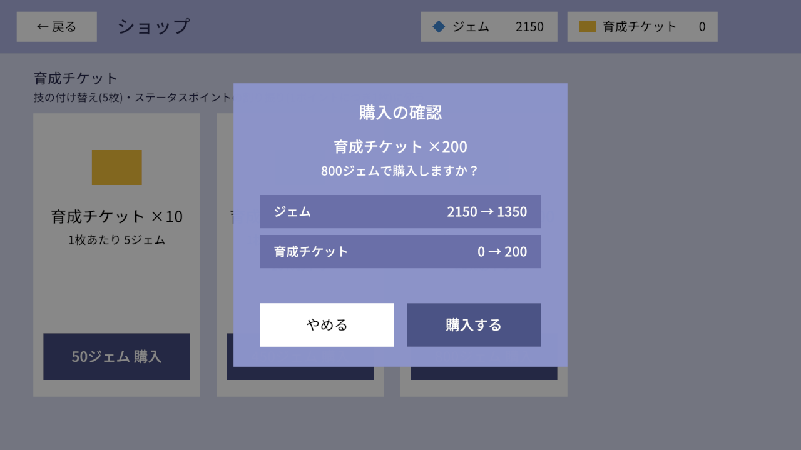
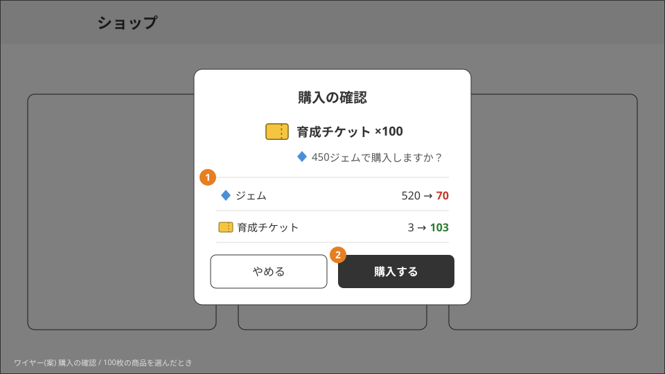
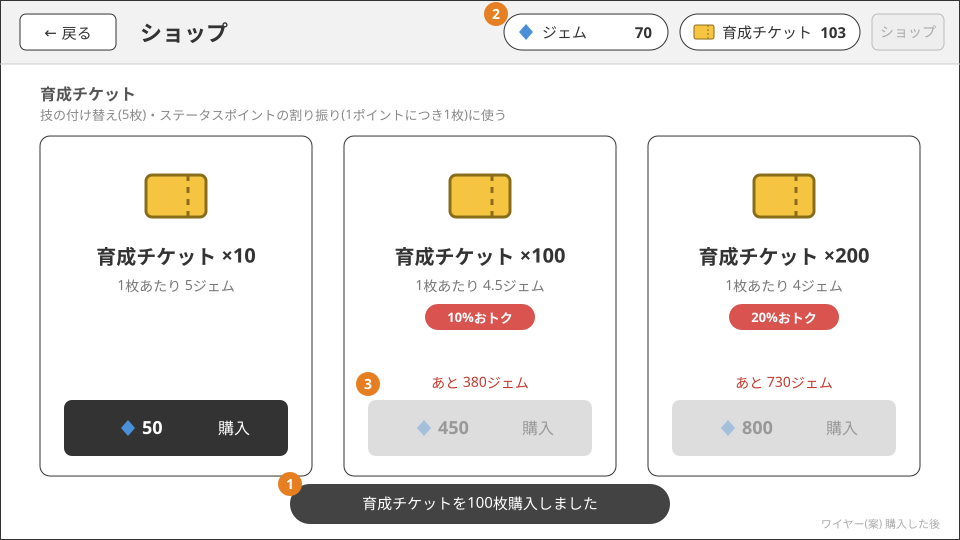

# ショップ

ジェムを使ってアイテムを購入する。今のところ商品は育成チケットだけ。どの画面からでもヘッダーの「ショップ」で開け、
育成でチケットが足りないときは、その場から案内する。

## ルール

- 商品を選び、表示された値段のジェムを払って購入する。ジェムが足りなければ購入できない
- 購入したアイテムは所持品として持ち、使うと減る(育成チケットは技の付け替えで5枚、ステータスポイントの割り振りで1ポイントにつき1枚使う。[パーティ編成・育成](party-training.md))
- 育成チケットは10枚50ジェム、100枚450ジェム、200枚800ジェムで交換できるように複数の商品を並べる。まとめて買うほど1枚あたりが安い
- 商品はマスタで持ち、販売期間は無い(マスタにある商品はいつでも買える)
- 購入履歴は残さない
- 所持しているアイテムの数を確認できる
- アウトゲームの画面に共通のグローバルヘッダーの「ショップ」から開く(ホームでも同じボタンから開く)。今の画面の上に開き、戻ると元の画面に戻る
  ([ホームと画面の流れ](home.md)の「グローバルヘッダー」)。育成でチケットが足りないときも、同じショップを開けるようにする

## 画面の設計

実装の前に描いたワイヤーと、各部分をそうした理由。見た目(色・アイコン・文言)は実際の画面と異なる。

### ショップ画面

1. 所持しているジェムと育成チケットの数は、グローバルヘッダーに出す。アイテムは2種類だけなので、所持品の一覧画面は作らずこれで
   「所持数の確認」を満たす。ショップの中ではヘッダーの「ショップ」を出さない
2. まとめ買いの商品には、10枚の商品と比べた割引率(「◯%おトク」)と1枚あたりの値段を出す。書かないとまとめ買いが安いことが伝わらないため
3. 購入ボタンにはジェムの値段を載せる。押すと確認へ進む
4. ジェムが足りない商品は、ボタンを押せなくして「あと◯ジェム」と出す。押してからエラーを出すより、買えない理由と足りない量が先に分かるため

### 購入の確認

1. 購入する前と後のジェム・チケットの数を並べる。200枚の商品は勝利16回分のジェムを使うので、押し間違いで失わないように必ず確認を挟む
2. 「購入する」で購入する。「やめる」ではショップ画面に戻る

### 購入した後

1. 購入できたことをトーストで短く知らせ、ショップ画面に残る(続けて買うことも、戻ることもできる)
2. 所持数の表示を購入後の数に更新する
3. 買える・買えない(「あと◯ジェム」)の表示も購入後のジェムで出し直す

### 育成画面からショップへ

1. 育成でチケットが足りないときに「ショップへ」を出す。押すとグローバルヘッダーの「ショップ」と同じショップを育成画面の上に開き、
   戻ると育成画面に戻る。チケットは育成にしか使わないので、ショップに来るのはほとんどが育成の途中でチケットが足りなくなった人で、
   ヘッダーに入口があっても、足りないと分かったその場で案内したほうが迷わないため

## 作りの要点

| 層 | していること | 詳しく |
|---|---|---|
| マスターデータ | 商品はマスタ `shop_products` で持つ(育成チケット10枚 = ジェム50、100枚 = 450、200枚 = 800)。商品を足すのにコードを変えない | [ショップ(API)](../server/shop.md)・[テーブル](../master-data/tables.md) |
| APIサーバー | 支払いは「足りる行だけを減らす」1文の `UPDATE` で、不足の判定と減算を同時に行う。受け取りと同じトランザクションで行い、再送で二重に購入しない | [ショップ(API)](../server/shop.md)・[所持リソース(アイテム)](../conventions/items.md) |
| APIサーバー | ジェムもチケットも、専用の列ではなく `items`/`player_items` の1行として持つ。新しい通貨やアイテムを足しても、テーブルと API の形が変わらない | [所持リソース(アイテム)](../conventions/items.md) |
| クライアント | 開発用のジェム付与を、ショップの商品の左に置く(開発ビルドと Editor だけ) | [画面の構成](../client/screens.md) |

未確定のこと(1つの商品を一度に複数個買えるか、購入数の上限)は [#36](https://github.com/chinpanGX/Atlas/issues/36)。
