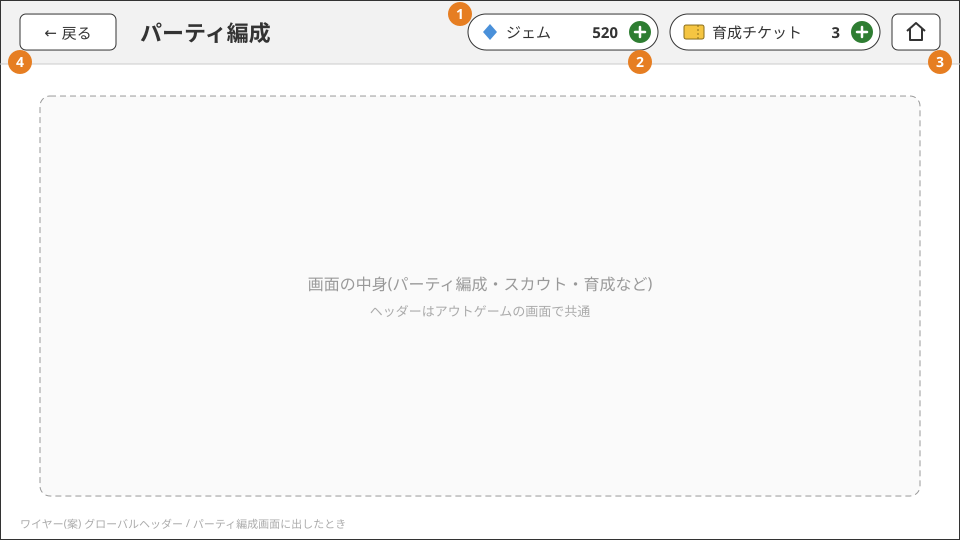

# 遊びの流れとアカウント

## コアループ

```
① スカウトでパチモンを集める(ジェムを使う)
      ↓
② 育成する(技の付け替え、ステータスポイントの割り振り。どちらもジェムで交換したチケットを使う)
      ↓
③ パーティを編成する(最大6体)
      ↓
④ マッチングに参加し、対戦相手と組む
      ↓
⑤ パーティを見せ合って3体を選び、リアルタイムで対戦する
      ↓
① へ戻る(勝つとジェムがもらえる。ジェムはスカウトと、ショップでの育成チケットの購入に使う)
```

いま遊べるのは ①〜⑤と、育成チケットを買うショップ。② のうち技の付け替えは、付け替える技の候補の画面が無い。

## 用語

| 用語 | 意味 |
|---|---|
| パチモン | 集めて戦わせるモンスター。種族ごとにタイプ・能力・覚えられる技が決まっている |
| 個体 | プレイヤーが所持している1体1体のパチモン。同じ種族を複数持てる |
| ジェム | スカウトとショップで使う通貨。対戦に勝つと増える |
| スカウト | ジェムを使ってパチモンを入手する抽選(ガチャ) |
| パーティ | 対戦に連れていく最大6体 |
| 育成 | 個体の技を付け替えたり、ステータスポイントを割り振ったりして、対戦向けに調整すること |
| ステータスポイント | 個体ごとに持つ64ポイント。6つの能力に自由に割り振って能力を上げる(画面は未実装) |
| 育成チケット | ショップでジェムと交換するアイテム。技の付け替え1回で5枚、ステータスポイントは増やした1ポイントにつき1枚使う |
| ショップ | ジェムでアイテムを購入する場所 |
| 選出 | 対戦の直前に、パーティから実際に戦わせる3体を選ぶこと |

「ポケモン」にあたる語は、商標と混同しないよう「パチモン」(コードでは `pachimon`)で統一している。

## 画面の流れ

```
起動 ─→ タイトル(「スタート」でゲスト認証。初回はプレイヤーを作成)
          ↓
        ホーム ─┬─ パーティ編成
                ├─ スカウト
                ├─ 対戦 ─→ マッチング待ち ─→ 選出 ─→ 対戦 ─→ 結果 ─→ ホーム
                └─ 育成(パーティ編成の「育成する」からも開く。技の付け替えの候補の画面は未実装)

アウトゲームの各画面 ─(グローバルヘッダーの「ショップ」)─→ ショップ ─(戻る)─→ 元の画面
```

- 開発用に、ホームにジェムを付与するボタンがある(正式な機能ではない。[ジェム](gems.md))
- 通信エラーで「タイトルへ」を選ぶと、手元の所持データを捨ててタイトルからやり直す

### グローバルヘッダー

アウトゲームの画面に共通で出すヘッダー。ワイヤーは案で、見た目は仮。



1. 所持しているジェムと育成チケットの数を出す。スカウト・育成・ショップのどこでも「あといくらあるか」を確かめられるようにするため
2. 「ショップ」でショップを開く。ホームを含むどの画面でも押せる。ショップは今の画面の上に開き、戻ると元の画面に戻る。
   画面を切り替える(タブのように入れ替える)と、育成の途中で選んでいた個体や編集中の内容が消えるため。ショップの中では出さない
   (ショップの上にショップを重ねないため)
3. 戻るは1つ前の画面に戻る(今までどおり)。ホームでは出さない

- パーティ編成は、ヘッダーの戻るで離れるときに変更を保存する。保存に失敗したら画面に留まる
- ヘッダーに置くのは、所持数とショップだけにする。機能(パーティ編成・スカウト・対戦・育成)は5つと少なく、ホームから入れば足りるため
- 途中で抜けると進行が壊れる画面では、ヘッダーを出さないか押せなくする: マッチング待ち、選出、対戦、スカウトで候補を選んでいる間(選ぶまで戻れない)

#### 採用しなかった案

- 所持数の横に「＋」を置いてショップを開く: ショップの商品は育成チケットだけで、ジェムは買えない(対戦の勝利で増える)。ジェムの横の
  「＋」を押した人はジェムを買えると期待するので、何が開くかを「ショップ」と書いたボタン1つにした
- ヘッダーにホームへ戻るボタンを置く: 画面の深さは最大でも「ホーム → 育成 → ショップ」の3段で、戻るを2回押せば足りる。空いた場所に
  ショップを置いた

## アカウント

- 会員登録(メールアドレス・パスワード等)は無い。初回の通信で、端末ごとのゲストアカウントを自動で作る
- 別の端末への引き継ぎは無い
- 初回はプレイヤーを作成し、次のものを受け取る
  - スターターパーティ: 全プレイヤー共通の固定6体(レア度 C の6体)。受け取った時点でパーティに編成済みで、すぐに対戦できる
  - ジェム 300(スカウト2回分)
- ニックネームの入力画面は無く、作成時は固定の「プレイヤー」になる

作りは [プレイヤー(サインアップ・サインイン)](../server/player.md) と [サインイン(クライアント)](../client/sign-in.md)。
