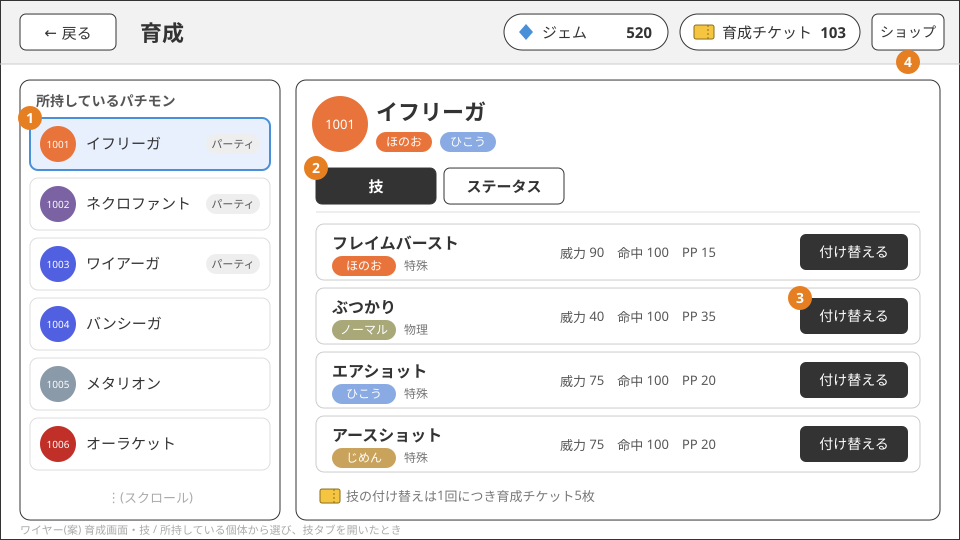
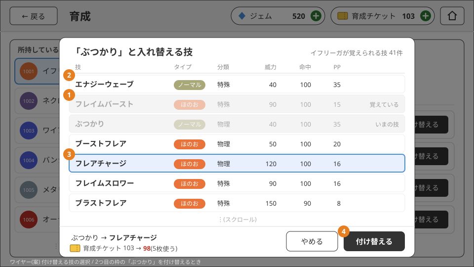
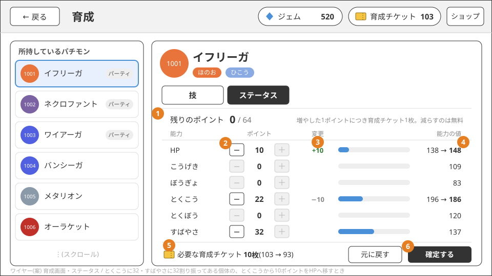

# パーティ編成・育成

## パーティ編成

- 所持している個体から1〜6体を選んで編成する
- 同じ個体を2つの枠に入れることはできない。同じ種族の別の個体なら何体でも入れられる
- パーティが0体だと対戦に参加できない
- 編成画面で個体を選ぶと、その能力と覚えている技を確かめられる

## 育成
育成画面で行う。育成画面はホームの「育成」と、編成画面の詳細に出している個体の「育成する」から開く。

- 編成画面から開いたときは、詳細に出していた個体を選んだ状態で開く。ホームから開いたときはパーティの先頭(パーティが空なら一覧の先頭)を選ぶ
- 編成画面で編成を変えていれば、育成画面を開く前に保存する。育成画面ではパーティに入っている個体に印を付けるので、
  保存前の編成と印がずれないようにするため。保存に失敗したときは開かない
- 開いたときは技のタブを出す

育成には育成チケットを使う。チケットはショップでジェムと交換して手に入れる([ショップ](shop.md))。
チケットが足りないときは「ショップへ」を出し、育成画面の上にショップを開く(グローバルヘッダーの「ショップ」からも開ける)。
買い終えて戻ると育成画面に戻る。チケットは育成にしか使わないため、ホームを経由せずにその場で補充できるようにする。

## 技の付け替え

- 個体が覚えている4つの技のうち1つを、その種族の技の候補の中から選んで入れ替える
- 候補は、その種族が覚えられる技のすべて(最初から覚えていた技も含む)。最初の技に戻せるようにするため
- 1回の付け替えで育成チケットを5枚使う。足りなければ付け替えられない
- 次の付け替えはできない(チケットは使わない)。チケットを多く使うので、意味の無い操作でチケットを失わないようにするため
  - 今と同じ技に付け替える
  - 別の枠で覚えている技を、もう1つ覚える(同じ技を2つ持つ)
- 育成画面の技のタブの「付け替える」から、その枠に入れる技の候補を開いて付け替える。サーバーも上の2つを業務エラーで断る
  ([パーティ編成・育成(API)](../server/party.md))
- 候補は技グループの並び(マスタ `move_group_moves` の順)で並べる

## ステータスポイントの割り振り

- 個体ごとにステータスポイントを64持ち、6つの能力(HP・こうげき・ぼうぎょ・とくこう・とくぼう・すばやさ)に自由に割り振る
- 1つの能力に割り振れる上限は無い(64ポイントを1つの能力に全部入れてもよい)
- 割り振ったポイントは、種族値から計算した能力の値にそのまま足す(ポケモンチャンピオンズ準拠)。入手したときは全能力0
- 割り振りは何度でも変えられる。**増やしたポイントの数だけ**育成チケットを使い(1ポイントにつき1枚)、減らすのは無料
  - 例: 何も割り振っていない個体に64ポイントを割り振ると64枚。こうげきから10ポイント外してすばやさに10ポイント足すと10枚
  - 最初の割り振りも振り直しも同じルールで数えられるようにするため
- 画面で複数の能力のポイントをまとめて調整してから確定し、そのとき必要な枚数を一度に使う。チケットが足りなければ何も変わらない
- 64ポイントを使い切らずに確定してよい(残りは後で足せる)。チケットが少ないうちから少しずつ育てられるようにするため
- 割り振りの API と、バトルサーバーの能力の計算への反映はある([バトルの計算](../battle-server/battle-core.md))。
  育成画面のステータスのタブで割り振れる。編成画面の能力の表示には、割り振りをまだ足していない

## 育成画面のワイヤー(案)

レイアウトと振る舞いの案。見た目(色・アイコン・文言)は仮。ヘッダーはアウトゲームに共通のグローバルヘッダー
([遊びの流れとアカウント](flow.md))。

### 技

1. 左に所持している個体の一覧を出し、選んだ個体を右に表示する。パーティに入っている個体には印を付ける。
   パーティの6体に限らないのは、控えの個体を育ててから編成に入れることがあるため。編成画面から来たときは、そこで選んでいた個体を選んだ状態で開く
2. 技とステータスはタブで切り替える。どちらも同じ個体に対する操作で、個体を選び直さずに行き来できるようにするため
3. 覚えている4つの技ごとに「付け替える」を置く。押すと、その枠に入れる技の候補を開く。チケットが5枚より少なければ、
   候補を開かずにチケット不足のダイアログ(「ショップへ」付き。[ショップ](shop.md))を出す。候補を選んでから足りないと分かるのを防ぐため
4. ヘッダーの「ショップ」からも、育成画面の上にショップを開ける

### 付け替える技の選択

1. 付け替えられない技(別の枠で覚えている技、いまの技)は、候補には並べたまま灰色にして理由を出す。消すと「なぜこの技が無いのか」が分からないため
2. 候補は、その種族が覚えられる技すべてを、タイプ・分類・威力・命中・PPと一緒に並べる
3. 技を選ぶと下に「いまの技 → 選んだ技」と、チケットの数の変化(5枚使う)を出す
4. 「付け替える」で確定する。別の確認ダイアログは挟まない。下の欄で変化を見せたうえで、技を選ぶ・押すの2段階になっていて、
   5枚の操作に確認をさらに重ねると手数が多くなるため

### ステータス

1. 残りのポイント(64から割り振った分を引いた数)を出す。残りが0のときは「＋」を押せなくする
2. 能力ごとに「−」「＋」でポイントを調整する。確定するまではサーバーに送らず、画面の中だけで変える
3. 確定済みの割り振りからの変化を能力ごとに出す(増やした分は緑、減らした分は灰色)。増やした分だけがチケットの枚数になることが分かるようにするため
4. 能力の値を「確定済みの値 → 調整後の値」で出す。ポイントの数より、対戦で使う値がどう変わるかのほうが判断に使えるため
5. 必要なチケットの枚数(増やしたポイントの合計)と、確定した後の所持数を出す
6. 「確定する」で必要な枚数を一度に使って保存する。チケットが足りなければ、確定せずにチケット不足のダイアログを出す。
   「元に戻す」は確定済みの割り振りに戻す

- 確定していない調整があるときに、別の個体を選ぶ・タブを切り替える・画面を離れると、調整を捨てるかを確認する。黙って捨てると、
  まとめて調整した内容を失うため

## 採用しなかった案

- 割り振りを変更するたびに、変えたポイントの数に関係なくチケットを1枚使う: 64ポイントを1枚で割り振れてしまい、チケットの価値が小さくなるため
- 割り振ったポイントを戻せない、または全部を0に戻すだけにする: 少し動かしたいだけのときも最初からやり直しになるため
- 技の付け替えを1回1枚にする: ステータスポイントを1ポイント1枚にしたのに合わせ、技の付け替えの重みを上げた
