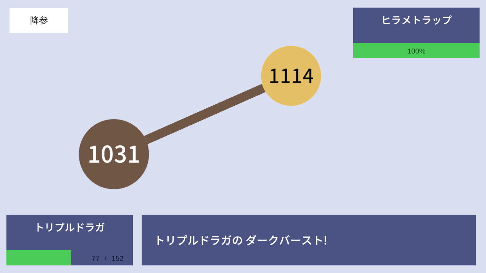
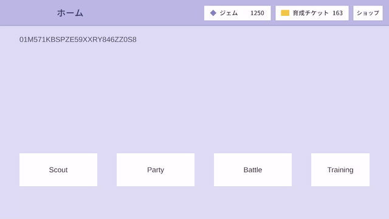
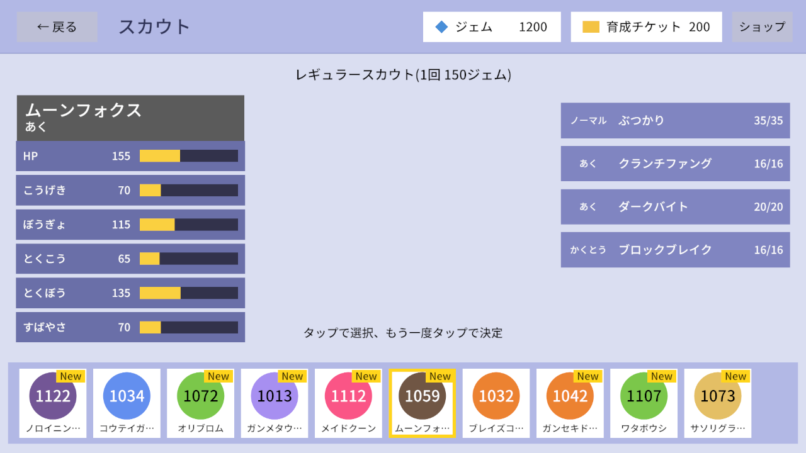
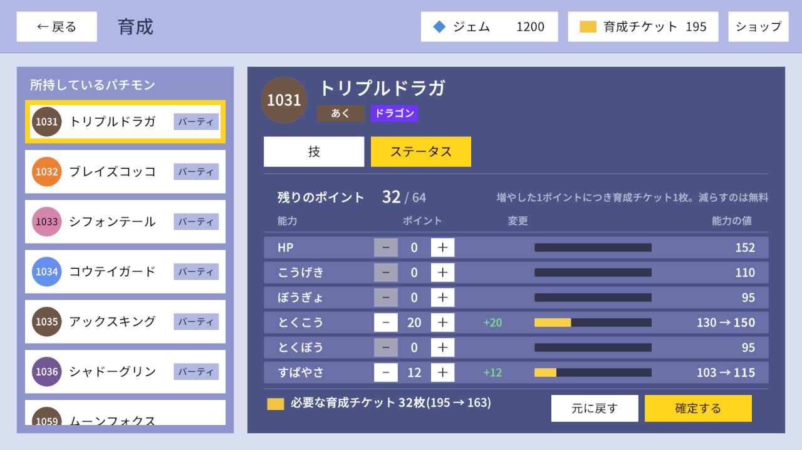
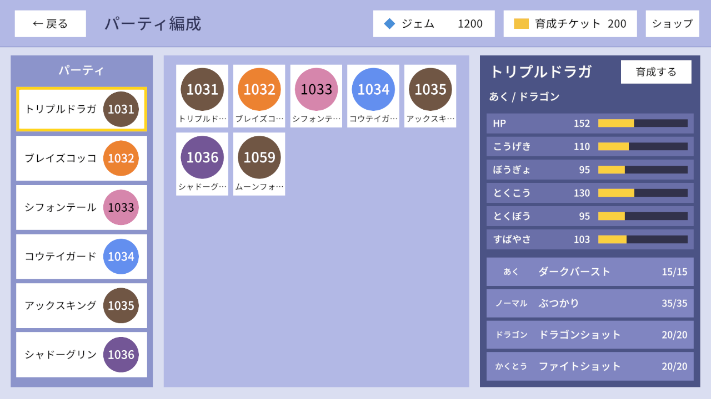
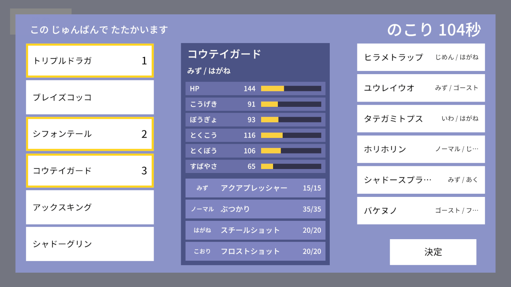
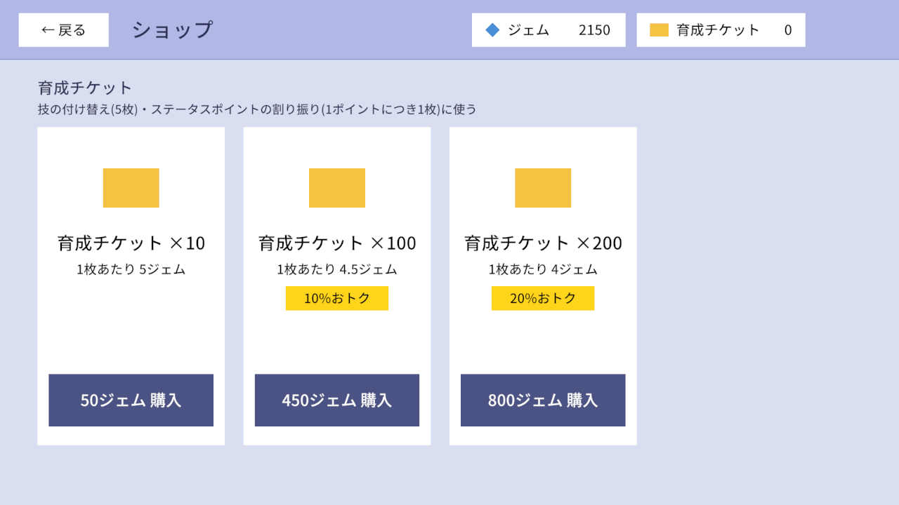

# Atlas

**モンスターを集めて育て、ほかのプレイヤーとリアルタイムで1対1の対戦をするゲーム。**
Unity クライアント・Rust の APIサーバー・C#/MagicOnion のバトルサーバーを、gRPC 基盤やマスターデータの生成ツールまで含めて1人で作っている。

| 項目       | 内容                                                                    |
| -------- | --------------------------------------------------------------------- |
| ジャンル     | モンスター収集 × リアルタイム対戦(1対1)                                               |
| プラットフォーム | Windows(Unity 6.6、IL2CPP)                                             |
| 開発       | 個人開発(2026年9月〜)。クライアント・サーバー・基盤・ツールのすべて                                 |
| 規模       | クライアント 約11,000行(C#)、APIサーバー 約5,800行(Rust)、バトルサーバーと共有のロジック 約5,200行(C#) |

## プレイの流れ

|                                                                                                                                     |                                                                                                                                              |
| ----------------------------------------------------------------------------------------------------------------------------------- | -------------------------------------------------------------------------------------------------------------------------------------------- |
|  **① [スカウト](features/scout.md)** — 候補10体から1体を選んで仲間にする       |  **② [育成](features/party-training.md)** — 技の付け替えとステータスポイントの割り振り |
|  **③ [パーティ編成](features/party-training.md)** — 対戦に連れていく6体を選ぶ |  **④ [マッチングと選出](features/battle.md)** — パーティを見せ合って3体を選ぶ               |
|  **⑤ [対戦](features/battle.md)** — 毎ターン技か交代を選ぶ。勝つとジェムを獲得できる        |  **[ショップ](features/shop.md)** — ジェムで育成チケットを買う                                     |

ゲームの全体とルールは [ゲーム紹介](features/index.md)。

## 技術

設計の見どころは [概要](overview.md)、使っているライブラリ・ツールは [利用技術](tech-stack.md)。

## 読み方

- 遊べるものを見る: [ゲーム紹介](features/index.md) → 各機能のページ(スクリーンショット・ルール・作りの要点)
- 全体の構成と設計の見どころ: [概要](overview.md)
- 作りを詳しく見る: 下の「技術資料」(APIサーバー → DB → バトルサーバー → クライアント)
- 環境を作って動かす: [開発環境ガイド](development.md)
- コーディング規約: [共通](../../CLAUDE.md)・[APIサーバー](../../Server/CLAUDE.md)・[バトルサーバー](../../BattleServer/CLAUDE.md)・[クライアント](../../Client/AtlasUnityProject/CLAUDE.md)(各プロジェクトの `CLAUDE.md`)

## ページ一覧

状態: `current` 実装済み(当面の方針)/ `planned` 追加予定 / `confirmed` 確定。決まっていないことは [GitHub Issues](https://github.com/chinpanGX/Atlas/issues)

### [機能](features/index.md)

| ページ | 状態 | 内容 |
|---|---|---|
| [ゲーム紹介](features/index.md) | `index` | 機能の一覧、コアループ、用語、ジェムの増減、対象外にしたもの |
| [タイトルとアカウント](features/account.md) | `current` | ゲストアカウント、初回に受け取るもの |
| [ホームと画面の流れ](features/home.md) | `current` | 画面の流れ、グローバルヘッダー |
| [パチモン](features/pachimon.md) | `current` | 種族・タイプ・能力・個体・技 |
| [パーティ編成・育成](features/party-training.md) | `current` | 編成、技の付け替え、ステータスポイント |
| [スカウト](features/scout.md) | `current` | 候補10体から1体を選ぶ抽選 |
| [ショップ](features/shop.md) | `current` | ジェムで育成チケットを買う |
| [対戦](features/battle.md) | `current` | マッチング・選出・ターン・ダメージ・勝敗、作りの要点 |

### 全体

| ページ | 状態 | 内容 |
|---|---|---|
| [概要](overview.md) | `current` | システムの全体像、通信の一覧、リポジトリ構成、生成物 |
| [利用技術](tech-stack.md) | `current` | 各層の言語・ランタイムと、ライブラリ・ツールの用途・ライセンス・導入経路 |
| [開発環境ガイド](development.md) | `current` | 環境構築、共通の設定(環境変数・シークレット)、起動手順、よく使うコマンド、トラブルシューティング |

### 技術資料

#### [共通の決まり](conventions/index.md)

| ページ | 状態 | 内容 |
|---|---|---|
| [命名とID](conventions/naming-and-ids.md) | `current` | 命名規則、ULID とマスタの ID |
| [値なしの表し方(nullable)](conventions/nullable.md) | `current` | 番兵値と、行が無いことで表す方針 |
| [所持データの差分(player_diff)](conventions/player-diff.md) | `current` | 所持データを変える API の共通の形 |
| [所持リソース(アイテム)](conventions/items.md) | `current` | ジェムを `items`/`player_items` で持つ |
| [業務エラー](conventions/errors.md) | `current` | reason と action、返し方 |

#### [APIサーバー](server/index.md)

| ページ | 状態 | 内容 |
|---|---|---|
| [構成](server/structure.md) | `current` | ポート、Layer、ログ、ディレクトリ、トランザクション、API 一覧 |
| [ゲームログ](server/game-log.md) | `current` | 所持データの変化の履歴(何を、どの形で残すか) |
| [認証](server/auth.md) | `current` | デバイス認証、`battle_token`、内部 API のシークレット |
| [プレイヤー](server/player.md) | `current` | サインアップ・サインイン |
| [パーティ編成・育成](server/party.md) | `current` | `SetParty`・`SetPachimonMove`・`SetPachimonStatPoints` |
| [スカウト(API)](server/scout.md) | `current` | `ListBanners`・`Roll`・`Select` |
| [ショップ(API)](server/shop.md) | `current` | `ListProducts`・`Purchase` |
| [マッチング](server/matchmaking.md) | `current` | メモリの待機列とポーリング、相手がいないときのボット |
| [内部API](server/internal-api.md) | `current` | バトルサーバー向けの3つの RPC |
| [結果報告が届かない対戦の後始末](server/stale-match-cleanup.md) | `current` | 定期的な打ち切り |
| [開発用API](server/debug-api.md) | `current` | `DebugService` |

#### [DB](db/index.md)

| ページ | 状態 | 内容 |
|---|---|---|
| [DB](db/index.md) | `current` | 方針と、全テーブルの列・つながり |

#### [マスターデータ](master-data/index.md)

| ページ | 状態 | 内容 |
|---|---|---|
| [生成・配布・運用](master-data/pipeline.md) | `current` | 配布先、パイプラインの制約、更新の手順 |
| [テーブル](master-data/tables.md) | `current` | 各マスタの列と件数 |

#### [クライアント](client/index.md)

| ページ | 状態 | 内容 |
|---|---|---|
| [アセンブリとレイヤー](client/assemblies.md) | `current` | オニオンアーキテクチャと asmdef |
| [シーンとスコープ](client/scenes-and-scopes.md) | `current` | 3シーンと VContainer のスコープ |
| [画面の構成](client/screens.md) | `current` | View / Presenter、命名、画面一覧 |
| [画面遷移](client/navigation.md) | `current` | Push/Pop、直列化、シーンの切り替え |
| [サービスと所持データ](client/services-and-player-data.md) | `current` | Service・Repository・差分の反映 |
| [サインイン](client/sign-in.md) | `current` | タイトルからのサインイン、アカウント情報 |
| [バトル画面](client/battle-screen.md) | `current` | 選出・開始の繰り出し・状態・演出・交代 |
| [通信エラーのダイアログ](client/error-dialog.md) | `current` | ボタンと遷移、文言 |

#### [バトルサーバー](battle-server/index.md)

| ページ | 状態 | 内容 |
|---|---|---|
| [構成](battle-server/structure.md) | `current` | プロジェクト、クラスの役割、共有ソース |
| [バトルの計算](battle-server/battle-core.md) | `current` | Section とイベント、ダメージ・能力の式 |
| [通信契約](battle-server/contracts.md) | `current` | Hub と Receiver、情報の見せ方 |
| [対戦の進行](battle-server/battle-flow.md) | `current` | フェーズ、時間切れ、切断と再接続、ボットとの対戦 |
| [APIサーバーとの連携](battle-server/api-integration.md) | `current` | 内部 API、結果報告の再送 |
| [テストとボット](battle-server/testing-and-bot.md) | `current` | NUnit・xUnit、自動対戦のクライアント |

wiki の書き方と更新のルールは [CLAUDE.md](CLAUDE.md)。
