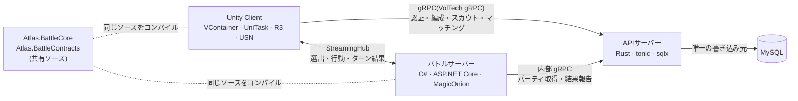

# Atlas wiki

**Atlas** は、モンスター(「パチモン」)を集めてパーティを組み、ほかのプレイヤーとリアルタイムで1対1の対戦をするゲーム。
Unity クライアント・Rust の APIサーバー・C#/MagicOnion のバトルサーバーの3つで構成している。

この wiki は、ゲームの仕様と、各プログラムが「何を・なぜそうしたか」を、`develop` の実装に合わせてまとめたもの。

## 見どころ

| テーマ | 内容 | 読むページ |
|---|---|---|
| サーバー権威のリアルタイム対戦 | 判定はバトルサーバーだけが持ち、HP は%で、相手の選出は場に出るまで送らない。切断から60秒以内なら続きから再開できる | [対戦の進行](battle-server/battle-flow.md)・[通信契約](battle-server/contracts.md) |
| 計算ロジックの共有 | ダメージ計算・ターン処理を Unity とサーバーで同じソースにし、クライアントのオフライン対戦にも使う。技の効果はイベントのハンドラで足せる構造 | [バトルの計算](battle-server/battle-core.md) |
| 自作の gRPC 基盤 | デバイス認証・エラーのダイアログ・再送しても一度だけ処理する仕組みを基盤に寄せ、アプリは `.proto` と業務処理だけを書く | [APIサーバーの構成](server/structure.md)・[サービスと所持データ](client/services-and-player-data.md) |
| 所持データの差分の共通化 | 所持データを変える API は同じ形の差分(`player_diff`)を返し、クライアントは種別ごとに反映する | [所持データの差分](conventions/player-diff.md) |
| DB の書き込みを1か所に | バトルサーバーは DB を持たず、内部 API で取得・報告する。報告の二重実行・届かない報告の後始末まで扱う | [内部API](server/internal-api.md)・[後始末](server/stale-match-cleanup.md) |
| オニオンアーキテクチャの Unity クライアント | asmdef で依存の向きを強制し、Presenter は実装を知らない。テストは送り先だけを偽のサーバーに差し替える | [アセンブリとレイヤー](client/assemblies.md)・[テスト](client/testing.md) |
| マスターデータの生成パイプライン | スキーマと CSV を正本に、Rust・C# の型とデータを自作ツールで生成する | [マスターデータの生成・配布・運用](master-data/pipeline.md) |

## 技術スタック

| 層 | 技術 |
|---|---|
| クライアント | Unity 6.6(IL2CPP)、VContainer、UniTask、R3、LitMotion、ZLinq、Addressables、UnityScreenNavigator(フォーク)、MasterMemory、MessagePack、MagicOnion.Client |
| APIサーバー | Rust、tonic(gRPC)、sqlx、MySQL、jsonwebtoken |
| バトルサーバー | C#(.NET 10)、ASP.NET Core、MagicOnion、xUnit |
| 共通 | Protocol Buffers、[VolTech gRPC](https://github.com/chinpanGX/VolTech-gRPC)(自作)、[Supplement](https://github.com/chinpanGX/Supplement)(自作)、master-data-pipeline(自作) |

## 読み方

- まず全体をつかむ: [概要](overview.md) → [ゲームの仕様](game/index.md)
- サーバーを見る: [APIサーバー](server/index.md) → [DB](db/index.md) → [バトルサーバー](battle-server/index.md)
- クライアントを見る: [クライアント](client/index.md)
- 環境を作って動かす: [開発環境ガイド](development.md)
- コーディング規約: [共通](../../CLAUDE.md)・[APIサーバー](../../Server/CLAUDE.md)・[バトルサーバー](../../BattleServer/CLAUDE.md)・[クライアント](../../Client/AtlasUnityProject/CLAUDE.md)(各プロジェクトの `CLAUDE.md`)

## ページ一覧

状態: `current` 実装済み(当面の方針)/ `planned` 追加予定 / `open` 未確定 / `confirmed` 確定

### 全体

| ページ | 状態 | 内容 |
|---|---|---|
| [概要](overview.md) | `current` | ゲームとシステムの全体像、通信の一覧、リポジトリ構成、生成物 |
| [開発環境ガイド](development.md) | `current` | 環境構築、共通の設定(環境変数・シークレット)、起動手順、よく使うコマンド、トラブルシューティング |
| [未確定・保留](open-questions.md) | `open` | 決まっていないこと |

### [ゲームの仕様](game/index.md)

| ページ | 状態 | 内容 |
|---|---|---|
| [遊びの流れとアカウント](game/flow.md) | `current` | コアループ、用語、画面の流れ、ゲストアカウント |
| [パチモン](game/pachimon.md) | `current` | 種族・タイプ・能力・個体・技 |
| [パーティ編成・育成](game/party-training.md) | `current` | 編成、技の付け替え、ステータスポイント(追加予定) |
| [スカウト](game/scout.md) | `current` | 候補10体から1体を選ぶ抽選 |
| [ショップ(追加予定)](game/shop.md) | `planned` | ジェムで育成チケットを買う |
| [対戦のルール](game/battle-rules.md) | `current` | マッチング・選出・ターン・ダメージ・勝敗 |
| [ジェム](game/gems.md) | `current` | 増減のきっかけと量 |
| [対象外にしたもの](game/out-of-scope.md) | `current` | 小さなルールにするために入れていないもの |

### [共通の決まり](conventions/index.md)

| ページ | 状態 | 内容 |
|---|---|---|
| [命名とID](conventions/naming-and-ids.md) | `current` | 命名規則、ULID とマスタの ID |
| [値なしの表し方(nullable)](conventions/nullable.md) | `current` | 番兵値と、行が無いことで表す方針 |
| [所持データの差分(player_diff)](conventions/player-diff.md) | `current` | 所持データを変える API の共通の形 |
| [所持リソース(アイテム)](conventions/items.md) | `current` | ジェムを `items`/`player_items` で持つ |
| [業務エラー](conventions/errors.md) | `current` | reason と action、返し方 |

### [APIサーバー](server/index.md)

| ページ | 状態 | 内容 |
|---|---|---|
| [構成](server/structure.md) | `current` | ポート、Layer、ログ、ディレクトリ、トランザクション、API 一覧 |
| [ゲームログ](server/game-log.md) | `current` | 所持データの変化の履歴(何を残し、何がまだ残せないか) |
| [認証](server/auth.md) | `current` | デバイス認証、`battle_token`、内部 API のシークレット |
| [プレイヤー](server/player.md) | `current` | サインアップ・サインイン |
| [パーティ編成・技の付け替え](server/party.md) | `current` | `SetParty`・`SetPachimonMove` |
| [スカウト(API)](server/scout.md) | `current` | `ListBanners`・`Roll`・`Select` |
| [マッチング](server/matchmaking.md) | `current` | メモリの待機列とポーリング |
| [内部API](server/internal-api.md) | `current` | バトルサーバー向けの3つの RPC |
| [結果報告が届かない対戦の後始末](server/stale-match-cleanup.md) | `current` | 定期的な打ち切り |
| [開発用API](server/debug-api.md) | `current` | `DebugService` |

### [DB](db/index.md)

| ページ | 状態 | 内容 |
|---|---|---|
| [DB(方針と一覧)](db/index.md) | `current` | 方針とテーブル一覧 |
| [プレイヤーと所持データのテーブル](db/player-tables.md) | `current` | `players`・`player_*` |
| [スカウトのテーブル](db/scout-tables.md) | `current` | `scout_banners`・`scout_banner_rates`・`scout_rolls` |
| [対戦のテーブル](db/battle-tables.md) | `current` | `battle_matches`・`battle_turns` |

### [マスターデータ](master-data/index.md)

| ページ | 状態 | 内容 |
|---|---|---|
| [生成・配布・運用](master-data/pipeline.md) | `current` | 配布先、パイプラインの制約、更新の手順 |
| [テーブル](master-data/tables.md) | `current` | 各マスタの列と件数 |

### [クライアント](client/index.md)

| ページ | 状態 | 内容 |
|---|---|---|
| [採用ライブラリ](client/libraries.md) | `current` | ライブラリと導入経路 |
| [アセンブリとレイヤー](client/assemblies.md) | `current` | オニオンアーキテクチャと asmdef |
| [シーンとスコープ](client/scenes-and-scopes.md) | `current` | 3シーンと VContainer のスコープ |
| [画面の構成](client/screens.md) | `current` | View / Presenter、命名、画面一覧 |
| [画面遷移](client/navigation.md) | `current` | Push/Pop、直列化、シーンの切り替え |
| [サービスと所持データ](client/services-and-player-data.md) | `current` | Service・Repository・差分の反映 |
| [サインイン](client/sign-in.md) | `current` | タイトルからのサインイン、アカウント情報 |
| [バトル画面](client/battle-screen.md) | `current` | 選出・状態・演出・交代 |
| [通信エラーのダイアログ](client/error-dialog.md) | `current` | ボタンと遷移、文言 |
| [テストとサーバー無しでの動作](client/testing.md) | `current` | 偽のサーバー、Mock 対戦 |

### [バトルサーバー](battle-server/index.md)

| ページ | 状態 | 内容 |
|---|---|---|
| [構成](battle-server/structure.md) | `current` | プロジェクト、クラスの役割、共有ソース |
| [バトルの計算](battle-server/battle-core.md) | `current` | Section とイベント、ダメージ・能力の式 |
| [通信契約](battle-server/contracts.md) | `current` | Hub と Receiver、情報の見せ方 |
| [対戦の進行](battle-server/battle-flow.md) | `current` | フェーズ、時間切れ、切断と再接続 |
| [APIサーバーとの連携](battle-server/api-integration.md) | `current` | 内部 API、結果報告の再送 |
| [テストとボット](battle-server/testing-and-bot.md) | `current` | xUnit、対戦相手ボット |

wiki の書き方と更新のルールは [CLAUDE.md](CLAUDE.md)。
